# Page graph

Generated by `docs/page-graph/scripts` (see [Regenerating](#regenerating)) from `server/routes`, `server/paths`,
controllers, views and `server/form-pages/apply`.

- Solid arrow: link / button. Dashed arrow: form POST/PUT or server redirect.
- In form flows, dashed arrows are conditional `next()` branches, labelled with their condition.
  **Orange, thick arrows depend on the application origin or cohort.**
- Task colours (all-scenarios diagram): blue = bail only, yellow = new cohorts only.
- Yellow nodes in the site navigation are only routed when `config.flags.cas2IsrEnabled` is on.

Rendered images: [site-navigation.svg](./site-navigation.svg), [form-flow-all.svg](./form-flow-all.svg), [form-flow-courtBail-prisonBail.svg](./form-flow-courtBail-prisonBail.svg), [form-flow-hcrd-hefr-rarr.svg](./form-flow-hcrd-hefr-rarr.svg), [form-flow-from_ap-atcr.svg](./form-flow-from_ap-atcr.svg), [form-flow-isc.svg](./form-flow-isc.svg).
Open [index.html](./index.html) in a browser to view all diagrams.

## Contents

1. [Site navigation](#1-site-navigation)
2. [Application form flow (all scenarios)](#2-application-form-flow-all-scenarios)
3. [Application form flow: Court bail, Prison bail](#3-application-form-flow-court-bail-prison-bail)
4. [Application form flow: HCRD, HFTR, RARR](#4-application-form-flow-hcrd-hftr-rarr)
5. [Application form flow: From AP, ATCR](#5-application-form-flow-from-ap-atcr)
6. [Application form flow: ISC](#6-application-form-flow-isc)
7. [Tasks by application type](#tasks-by-application-type)

## 1. Site navigation

```mermaid
%%{init: {"theme":"base","themeVariables":{"background":"#ffffff","primaryColor":"#ffffff","primaryBorderColor":"#333333","primaryTextColor":"#000000","secondaryColor":"#f5f5f5","tertiaryColor":"#ffffff","lineColor":"#333333","textColor":"#000000","titleColor":"#000000","clusterBkg":"#ffffff","clusterBorder":"#9e9e9e","edgeLabelBackground":"#ffffff"}}}%%
flowchart LR
  subgraph PAGE_GRAPH_ROOT[" "]
    direction LR
  
    DASH["Dashboard<br/>/"]
  
    subgraph STATIC["Static (footer / dashboard links)"]
      PRIV["Privacy notice<br/>/privacy-notice"]:::static
      COOK["Cookies<br/>/cookies"]:::static
      A11Y["Accessibility statement<br/>/accessibility-statement"]:::static
      IQH["Interview questions (HTML)<br/>/interview-questions.html"]:::static
      IQD["Interview questions (DOCX)<br/>/interview-questions.docx"]:::static
      MAINT["Maintenance<br/>/maintenance"]:::static
    end
  
    DASH --> IQH & IQD
    DASH -. "footer (every page)" .-> PRIV & COOK & A11Y
  
    subgraph START_BAIL["Start a bail application (original flow)"]
      BYS["Before you start (bail)<br/>/applications/before-you-start"]
      ORIG["Application type<br/>/applications/application-type"]
      SPN["Search by prison number<br/>/applications/search-by-prison-number"]
      SCRN["Search by CRN<br/>/applications/search-by-crn"]
      UPB["Unauthorised: prison bail<br/>/applications/unauthorised-prison-bail-application"]
      UCB["Unauthorised: court bail<br/>/applications/unauthorised-court-bail-application"]
    end
  
    subgraph START_NC["Start an application (new cohorts — cas2IsrEnabled flag)"]
      NC_ORIG["Application type<br/>/new-cohorts/applications/application-type"]:::flag
      NC_BYS["Before you start<br/>/new-cohorts/applications/before-you-start"]:::flag
      NC_SCRN["Search by CRN<br/>/new-cohorts/applications/search-by-crn"]:::flag
      NCB_BYS["Before you start (bail)<br/>/new-cohorts/applications/bail/before-you-start"]:::flag
      NCB_ORIG["Bail application type<br/>/new-cohorts/applications/bail/application-type"]:::flag
      NCB_SPN["Search by prison number<br/>/new-cohorts/applications/bail/search-by-prison-number"]:::flag
      NCB_SCRN["Search by CRN<br/>/new-cohorts/applications/bail/search-by-crn"]:::flag
      NCB_UPB["Unauthorised: prison bail<br/>/new-cohorts/.../bail/unauthorised-prison-bail-application"]:::flag
      NCB_UCB["Unauthorised: court bail<br/>/new-cohorts/.../bail/unauthorised-court-bail-application"]:::flag
    end
  
    CONFIRM_PERSON["Confirm applicant details<br/>(rendered by POST .../people/find-by-*)"]
  
    subgraph APPLY["Applications (referrer)"]
      INDEX["Your applications<br/>/applications"]
      PRISON["Prison applications<br/>/applications/prison"]
      SHOW{{"Application<br/>/applications/:id"}}
      TASKLIST["Task list<br/>(/applications/:id, not submitted)"]
      FORM[["Application form pages<br/>/applications/:id/tasks/:task/pages/:page<br/>(see form-flow diagram)"]]:::form
      INELIG["Not eligible<br/>/applications/:id/not-eligible"]
      SUBMITTED["Submitted application<br/>(/applications/:id, submitted)"]
      OVERVIEW["Application overview<br/>/applications/:id/overview"]
      CONFSUB["Confirm submission<br/>/applications/:id/confirm-submission"]
      CONFIRMED["Application confirmation<br/>(rendered by POST /submission)"]
      CANCEL["Cancel application<br/>/applications/:id/cancel"]
    end
  
    subgraph ASSESS["Assess (assessor)"]
      A_INDEX["Submitted applications<br/>/assess/applications"]:::assess
      A_OVERVIEW["Overview<br/>/assess/applications/:id/overview"]:::assess
      A_SHOW["Application<br/>/assess/applications/:id"]:::assess
      A_DETAILS["Assessment details<br/>/assess/applications/:id/assessment-details"]:::assess
      A_STATUS["Update status<br/>/assess/applications/:id/update-status"]:::assess
      A_STATUS_DETAILS["Status further information<br/>/assess/applications/:id/update-status/further-information/:statusName"]:::assess
    end
  
    subgraph REPORTS["Reports"]
      R_NEW["Reports<br/>/reports"]:::report
      R_UNAUTH["Not authorised<br/>/reports/unauthorised"]:::report
      R_DL["Download report<br/>/reports/:name"]:::report
    end
  
    %% Dashboard tiles (server/utils/userUtils.ts)
    DASH --> INDEX
    DASH --> BYS
    DASH --> NC_ORIG
    DASH --> A_INDEX
    DASH --> R_NEW
    DASH --> PRISON
  
    %% Original bail start flow
    BYS --> ORIG
    ORIG -- back --> BYS
    ORIG -. "POST select-application-origin" .-> SPN & SCRN & UPB & UCB
    SPN -- back --> ORIG
    SCRN -- back --> ORIG
    UPB -- back --> ORIG
    UCB -- back --> ORIG
    SPN -- "search by CRN instead" --> SCRN
    SPN -. "POST people/find-by-prison-number" .-> CONFIRM_PERSON
    SCRN -. "POST people/find-by-crn" .-> CONFIRM_PERSON
  
    %% New cohorts start flow
    NC_ORIG -- back --> DASH
    NC_ORIG -. "POST select-application-origin" .-> NCB_BYS & NC_BYS
    NC_BYS -- back --> NC_ORIG
    NC_BYS --> NC_SCRN
    NC_SCRN -- back --> NC_BYS
    NC_SCRN -. "POST people/find-by-crn" .-> CONFIRM_PERSON
    NCB_BYS -- back --> NC_ORIG
    NCB_BYS --> NCB_ORIG
    NCB_ORIG -- back --> NCB_BYS
    NCB_ORIG -. "POST bail/select-application-origin" .-> NCB_SPN & NCB_SCRN & NCB_UPB & NCB_UCB
    NCB_SPN -- back --> NCB_ORIG
    NCB_SCRN -- back --> NCB_ORIG
    NCB_UPB -- back --> NCB_ORIG
    NCB_UCB -- back --> NCB_ORIG
    NCB_SPN -. "POST bail/people/find-by-prison-number" .-> CONFIRM_PERSON
    NCB_SCRN -. "POST bail/people/find-by-crn" .-> CONFIRM_PERSON
  
    CONFIRM_PERSON -- back --> SPN & SCRN & NC_SCRN & NCB_SPN & NCB_SCRN
    CONFIRM_PERSON -. "POST /applications/create" .-> SHOW
  
    %% Applications
    INDEX <-- tabs --> PRISON
    INDEX -- "in progress" --> SHOW
    INDEX -- submitted --> OVERVIEW
    INDEX --> CANCEL
    CANCEL -. "POST cancel" .-> INDEX
    SHOW -. "not submitted" .-> TASKLIST
    SHOW -. "eligibility = no" .-> INELIG
    SHOW -. "required task incomplete" .-> FORM
    SHOW -. submitted .-> SUBMITTED
    TASKLIST -- "task links" --> FORM
    FORM -. "PUT page → next page / task list" .-> TASKLIST
    FORM -- "consent refused" --> INDEX
    TASKLIST --> CONFSUB
    TASKLIST --> INDEX
    CONFSUB -- back --> SHOW
    CONFSUB -. "POST submission" .-> CONFIRMED
    CONFIRMED --> INDEX
    INELIG -- "change answer" --> FORM
    INELIG -- "start new application" --> NC_ORIG & BYS
    SUBMITTED --> OVERVIEW
    OVERVIEW --> SHOW
    OVERVIEW --> INDEX
    OVERVIEW -. "POST add-note" .-> OVERVIEW
  
    %% Assess
    A_INDEX --> A_OVERVIEW
    A_OVERVIEW --> A_SHOW & A_DETAILS & A_STATUS & A_INDEX
    A_OVERVIEW -. "POST add-note" .-> A_OVERVIEW
    A_SHOW --> A_OVERVIEW
    A_DETAILS -- back --> A_OVERVIEW
    A_DETAILS -. "POST assessment-details/update" .-> A_OVERVIEW
    A_STATUS -- back --> A_OVERVIEW
    A_STATUS -. "POST (status has details)" .-> A_STATUS_DETAILS
    A_STATUS -. POST .-> A_OVERVIEW
    A_STATUS_DETAILS -- back --> A_STATUS
    A_STATUS_DETAILS -. POST .-> A_OVERVIEW
  
    %% Reports
    R_NEW -. "no permission" .-> R_UNAUTH
    R_NEW --> R_DL
    R_DL -. error .-> R_NEW
  end
  classDef flag fill:#fff4ce,stroke:#b58b00
  classDef assess fill:#e3f2fd,stroke:#1565c0
  classDef report fill:#f3e5f5,stroke:#6a1b9a
  classDef static fill:#eeeeee,stroke:#616161
  classDef form fill:#e8f5e9,stroke:#2e7d32
  style PAGE_GRAPH_ROOT fill:#ffffff,stroke:#ffffff
```



## 2. Application form flow (all scenarios)

Every page and branch, regardless of application type.

```mermaid
%%{init: {"theme":"base","themeVariables":{"background":"#ffffff","primaryColor":"#ffffff","primaryBorderColor":"#333333","primaryTextColor":"#000000","secondaryColor":"#f5f5f5","tertiaryColor":"#ffffff","lineColor":"#333333","textColor":"#000000","titleColor":"#000000","clusterBkg":"#ffffff","clusterBorder":"#9e9e9e","edgeLabelBackground":"#ffffff"}}}%%
flowchart TD
  subgraph PAGE_GRAPH_ROOT[" "]
    direction TD
    TL(["Task list<br/>/applications/:id"]):::tl
    subgraph s__Before_you_apply["Before you apply"]
      direction TB
      subgraph t__confirm_eligibility["Confirm eligibility"]
        direction TB
        confirm_eligibility__confirm_eligibility["confirm-eligibility"]
        confirm_eligibility__done(["↩ task list"]):::tl
      end
      subgraph t__confirm_consent["Confirm consent to apply"]
        direction TB
        confirm_consent__confirm_consent["confirm-consent"]
        confirm_consent__consent_refused["consent-refused"]
        confirm_consent__done(["↩ task list"]):::tl
      end
      subgraph t__cohort_selection["Type of application and licence details<br/><b>[new cohorts only]</b>"]
        direction TB
        cohort_selection__cohort_selection["cohort-selection"]
        cohort_selection__licence_dates_needed["licence-dates-needed"]
        cohort_selection__licence_dates["licence-dates"]
        cohort_selection__done(["↩ task list"]):::tl
      end
      subgraph t__referrer_details["Add referrer details"]
        direction TB
        referrer_details__confirm_details["confirm-details"]
        referrer_details__cpp_check["cpp-check"]
        referrer_details__community_probation_practitioner_details["community-probation-practitioner-details"]
        referrer_details__job_title["job-title"]
        referrer_details__contact_number["contact-number"]
        referrer_details__location["location"]
        referrer_details__done(["↩ task list"]):::tl
      end
      subgraph t__solicitor_details["Add solicitor details<br/><b>[bail only]</b>"]
        direction TB
        solicitor_details__has_solicitor["has-solicitor"]
        solicitor_details__contact_information["contact-information"]
        solicitor_details__done(["↩ task list"]):::tl
      end
    end
    subgraph s__About_the_applicant["About the applicant"]
      direction TB
      subgraph t__personal_information["Add personal information"]
        direction TB
        personal_information__working_mobile_phone["working-mobile-phone"]
        personal_information__custody_location["custody-location"]
        personal_information__immigration_status["immigration-status"]
        personal_information__gender["gender"]
        personal_information__pregnancy_information["pregnancy-information"]
        personal_information__done(["↩ task list"]):::tl
      end
      subgraph t__address_history["Add address history"]
        direction TB
        address_history__has_fixed_address["has-fixed-address"]
        address_history__last_fixed_address["last-fixed-address"]
        address_history__no_fixed_address["no-fixed-address"]
        address_history__previous_address["previous-address"]
        address_history__done(["↩ task list"]):::tl
      end
      subgraph t__equality_and_diversity_monitoring["Add equality and diversity monitoring information"]
        direction TB
        equality_and_diversity_monitoring__will_answer_equality_questions["will-answer-equality-questions"]
        equality_and_diversity_monitoring__disability["disability"]
        equality_and_diversity_monitoring__sex_and_gender["sex-and-gender"]
        equality_and_diversity_monitoring__sexual_orientation["sexual-orientation"]
        equality_and_diversity_monitoring__ethnic_group["ethnic-group"]
        equality_and_diversity_monitoring__white_background["white-background"]
        equality_and_diversity_monitoring__mixed_background["mixed-background"]
        equality_and_diversity_monitoring__asian_background["asian-background"]
        equality_and_diversity_monitoring__black_background["black-background"]
        equality_and_diversity_monitoring__other_background["other-background"]
        equality_and_diversity_monitoring__religion["religion"]
        equality_and_diversity_monitoring__military_veteran["military-veteran"]
        equality_and_diversity_monitoring__care_leaver["care-leaver"]
        equality_and_diversity_monitoring__parental_carer_responsibilities["parental-carer-responsibilities"]
        equality_and_diversity_monitoring__marital_status["marital-status"]
        equality_and_diversity_monitoring__done(["↩ task list"]):::tl
      end
    end
    subgraph s__Area__funding_and_ID["Area, funding and ID"]
      direction TB
      subgraph t__area_information["Add exclusion zones and preferred areas"]
        direction TB
        area_information__first_preferred_area["first-preferred-area"]
        area_information__second_preferred_area["second-preferred-area"]
        area_information__other_area_preferences["other-area-preferences"]
        area_information__exclusion_zones["exclusion-zones"]
        area_information__gang_affiliations["gang-affiliations"]
        area_information__family_accommodation["family-accommodation"]
        area_information__done(["↩ task list"]):::tl
      end
      subgraph t__funding_information["Confirm funding and ID"]
        direction TB
        funding_information__funding_cas2_accommodation["funding-cas2-accommodation"]
        funding_information__applicant_id["applicant-id"]
        funding_information__alternative_applicant_id["alternative-applicant-id"]
        funding_information__done(["↩ task list"]):::tl
      end
    end
    subgraph s__Offences_and_concerns["Offences and concerns"]
      direction TB
      subgraph t__provide_offences_and_convictions_details["Provide offences and convictions details<br/><b>[bail only]</b>"]
        direction TB
        provide_offences_and_convictions_details__offences_and_convictions_guidance["offences-and-convictions-guidance"]
        provide_offences_and_convictions_details__done(["↩ task list"]):::tl
      end
      subgraph t__alleged_offences["Add alleged offences<br/><b>[bail only]</b>"]
        direction TB
        alleged_offences__alleged_offences["alleged-offences"]
        alleged_offences__alleged_offence_data["alleged-offence-data"]
        alleged_offences__alleged_offences_summary["alleged-offences-summary"]
        alleged_offences__done(["↩ task list"]):::tl
      end
      subgraph t__current_offences["Add current offences<br/><b>[new cohorts only]</b>"]
        direction TB
        current_offences__current_offences["current-offences"]
        current_offences__current_offence_data["current-offence-data"]
        current_offences__done(["↩ task list"]):::tl
      end
      subgraph t__orders_and_licence_conditions["Add orders and licence conditions<br/><b>[new cohorts only]</b>"]
        direction TB
        orders_and_licence_conditions__licence_conditions["licence-conditions"]
        orders_and_licence_conditions__orders["orders"]
        orders_and_licence_conditions__done(["↩ task list"]):::tl
      end
      subgraph t__previous_unspent_convictions["Add previous unspent convictions"]
        direction TB
        previous_unspent_convictions__any_previous_convictions["any-previous-convictions"]
        previous_unspent_convictions__unspent_convictions_data["unspent-convictions-data"]
        previous_unspent_convictions__unspent_convictions["unspent-convictions"]
        previous_unspent_convictions__done(["↩ task list"]):::tl
      end
      subgraph t__add_probation_supervision_details["Add probation supervision details<br/><b>[bail only]</b>"]
        direction TB
        add_probation_supervision_details__supervised_by_probation["supervised-by-probation"]
        add_probation_supervision_details__community_probation_practitioner_details["community-probation-practitioner-details"]
        add_probation_supervision_details__contacted_cpp_about_current_risk_levels["contacted-cpp-about-current-risk-levels"]
        add_probation_supervision_details__you_must_contact_the_cpp["you-must-contact-the-cpp"]
        add_probation_supervision_details__serious_harm_risk_levels["serious-harm-risk-levels"]
        add_probation_supervision_details__done(["↩ task list"]):::tl
      end
      subgraph t__risk_information["Add information about concerns to the applicant and others<br/><b>[bail only]</b>"]
        direction TB
        risk_information__concerns["concerns"]
        risk_information__self_harm["self-harm"]
        risk_information__does_the_applicant_have_acct_notes["does-the-applicant-have-acct-notes"]
        risk_information__acct["acct"]
        risk_information__add_acct_note["add-acct-note"]
        risk_information__domestic_abuse_concerns["domestic-abuse-concerns"]
        risk_information__details_of_domestic_abuse_concerns["details-of-domestic-abuse-concerns"]
        risk_information__violence_and_arson["violence-and-arson"]
        risk_information__living_in_the_community["living-in-the-community"]
        risk_information__safety_of_staff["safety-of-staff"]
        risk_information__additional_concerns["additional-concerns"]
        risk_information__risk_management_arrangements["risk-management-arrangements"]
        risk_information__information_sources["information-sources"]
        risk_information__done(["↩ task list"]):::tl
      end
    end
    subgraph s__Risk_and_health_needs["Risk and health needs"]
      direction TB
      subgraph t__health_needs["Add health needs"]
        direction TB
        health_needs__health_needs_information["health-needs-information"]
        health_needs__liaison_and_diversion["liaison-and-diversion"]
        health_needs__substance_misuse["substance-misuse"]
        health_needs__physical_health["physical-health"]
        health_needs__mental_health["mental-health"]
        health_needs__communication_and_language_relevance_check["communication-and-language-relevance-check"]
        health_needs__communication_and_language["communication-and-language"]
        health_needs__learning_difficulties["learning-difficulties"]
        health_needs__learning_difficulties_details["learning-difficulties-details"]
        health_needs__brain_injury["brain-injury"]
        health_needs__brain_injury_details["brain-injury-details"]
        health_needs__other_health["other-health"]
        health_needs__information_sources["information-sources"]
        health_needs__done(["↩ task list"]):::tl
      end
      subgraph t__risk_to_self["Add risk to self information<br/><b>[new cohorts only]</b>"]
        direction TB
        risk_to_self__oasys_import["oasys-import"]
        risk_to_self__old_oasys["old-oasys"]
        risk_to_self__vulnerability["vulnerability"]
        risk_to_self__current_and_previous_risk["current-and-previous-risk"]
        risk_to_self__acct_data["acct-data"]
        risk_to_self__acct["acct"]
        risk_to_self__additional_information["additional-information"]
        risk_to_self__done(["↩ task list"]):::tl
      end
      subgraph t__risks_of_serious_harm_to_others["Add risk of serious harm to others<br/><b>[new cohorts only]</b>"]
        direction TB
        risks_of_serious_harm_to_others__oasys_import["oasys-import"]
        risks_of_serious_harm_to_others__summary["summary"]
        risks_of_serious_harm_to_others__old_oasys["old-oasys"]
        risks_of_serious_harm_to_others__manual_rosh_information["manual-rosh-information"]
        risks_of_serious_harm_to_others__risk_to_others["risk-to-others"]
        risks_of_serious_harm_to_others__risk_management_arrangements["risk-management-arrangements"]
        risks_of_serious_harm_to_others__cell_share_information["cell-share-information"]
        risks_of_serious_harm_to_others__additional_risk_information["additional-risk-information"]
        risks_of_serious_harm_to_others__done(["↩ task list"]):::tl
      end
    end
    subgraph s__Bail_information["Bail information"]
      direction TB
      subgraph t__bail_conditions["Add bail conditions<br/><b>[bail only]</b>"]
        direction TB
        bail_conditions__non_standard_bail_conditions["non-standard-bail-conditions"]
        bail_conditions__done(["↩ task list"]):::tl
      end
      subgraph t__bail_hearing_information["Add bail hearing information<br/><b>[bail only]</b>"]
        direction TB
        bail_hearing_information__bail_hearing_information["bail-hearing-information"]
        bail_hearing_information__done(["↩ task list"]):::tl
      end
    end
    subgraph s__Check_answers["Check answers"]
      direction TB
      subgraph t__check_your_answers["Check application answers"]
        direction TB
        check_your_answers__check_your_answers["check-your-answers"]
        check_your_answers__done(["↩ task list"]):::tl
      end
    end
    TL --> confirm_eligibility__confirm_eligibility
    confirm_eligibility__confirm_eligibility --> confirm_eligibility__done
    TL --> confirm_consent__confirm_consent
    confirm_consent__confirm_consent -.->|"hasGivenConsent = no"| confirm_consent__consent_refused
    confirm_consent__confirm_consent -.->|"hasGivenConsent ≠ no"| confirm_consent__done
    confirm_consent__consent_refused --> confirm_consent__done
    TL --> cohort_selection__cohort_selection
    cohort_selection__cohort_selection -.->|"cohort = isc"| cohort_selection__licence_dates_needed
    cohort_selection__cohort_selection -.->|"cohort ≠ isc"| cohort_selection__licence_dates
    cohort_selection__licence_dates_needed -.->|"licenceDatesNeeded = yes"| cohort_selection__licence_dates
    cohort_selection__licence_dates_needed -.->|"licenceDatesNeeded ≠ yes"| cohort_selection__done
    TL --> referrer_details__confirm_details
    referrer_details__confirm_details -.->|"origin = other"| referrer_details__cpp_check
    referrer_details__confirm_details -.->|"origin ≠ other"| referrer_details__job_title
    referrer_details__cpp_check -.->|"isCpp = yes"| referrer_details__contact_number
    referrer_details__cpp_check -.->|"isCpp ≠ yes"| referrer_details__community_probation_practitioner_details
    referrer_details__community_probation_practitioner_details --> referrer_details__job_title
    referrer_details__job_title --> referrer_details__contact_number
    referrer_details__contact_number -.->|"isCpp"| referrer_details__done
    referrer_details__contact_number -.->|"not isCpp"| referrer_details__location
    referrer_details__location --> referrer_details__done
    TL --> solicitor_details__has_solicitor
    solicitor_details__has_solicitor -.->|"hasSolicitor = no"| solicitor_details__done
    solicitor_details__has_solicitor -.->|"hasSolicitor ≠ no"| solicitor_details__contact_information
    solicitor_details__contact_information --> solicitor_details__done
    TL --> personal_information__working_mobile_phone
    personal_information__working_mobile_phone -.->|"custodial cohort"| personal_information__custody_location
    personal_information__working_mobile_phone -.->|"non-custodial cohort"| personal_information__immigration_status
    personal_information__custody_location --> personal_information__immigration_status
    personal_information__immigration_status --> personal_information__gender
    personal_information__gender --> personal_information__pregnancy_information
    personal_information__pregnancy_information --> personal_information__done
    TL --> address_history__has_fixed_address
    address_history__has_fixed_address -.->|"hasFixedAddress = yes"| address_history__last_fixed_address
    address_history__has_fixed_address -.->|"hasFixedAddress ≠ yes"| address_history__no_fixed_address
    address_history__last_fixed_address --> address_history__done
    address_history__no_fixed_address --> address_history__done
    address_history__previous_address --> address_history__done
    TL --> equality_and_diversity_monitoring__will_answer_equality_questions
    equality_and_diversity_monitoring__will_answer_equality_questions -.->|"willAnswer = no"| equality_and_diversity_monitoring__done
    equality_and_diversity_monitoring__will_answer_equality_questions -.->|"willAnswer ≠ no"| equality_and_diversity_monitoring__disability
    equality_and_diversity_monitoring__disability --> equality_and_diversity_monitoring__sex_and_gender
    equality_and_diversity_monitoring__sex_and_gender --> equality_and_diversity_monitoring__sexual_orientation
    equality_and_diversity_monitoring__sexual_orientation --> equality_and_diversity_monitoring__ethnic_group
    equality_and_diversity_monitoring__ethnic_group -.->|"ethnicGroup = white"| equality_and_diversity_monitoring__white_background
    equality_and_diversity_monitoring__ethnic_group -.->|"ethnicGroup = mixed"| equality_and_diversity_monitoring__mixed_background
    equality_and_diversity_monitoring__ethnic_group -.->|"ethnicGroup = asian"| equality_and_diversity_monitoring__asian_background
    equality_and_diversity_monitoring__ethnic_group -.->|"ethnicGroup = black"| equality_and_diversity_monitoring__black_background
    equality_and_diversity_monitoring__ethnic_group -.->|"ethnicGroup = other"| equality_and_diversity_monitoring__other_background
    equality_and_diversity_monitoring__ethnic_group -.->|"otherwise"| equality_and_diversity_monitoring__religion
    equality_and_diversity_monitoring__white_background --> equality_and_diversity_monitoring__religion
    equality_and_diversity_monitoring__mixed_background --> equality_and_diversity_monitoring__religion
    equality_and_diversity_monitoring__asian_background --> equality_and_diversity_monitoring__religion
    equality_and_diversity_monitoring__black_background --> equality_and_diversity_monitoring__religion
    equality_and_diversity_monitoring__other_background --> equality_and_diversity_monitoring__religion
    equality_and_diversity_monitoring__religion --> equality_and_diversity_monitoring__military_veteran
    equality_and_diversity_monitoring__military_veteran --> equality_and_diversity_monitoring__care_leaver
    equality_and_diversity_monitoring__care_leaver --> equality_and_diversity_monitoring__parental_carer_responsibilities
    equality_and_diversity_monitoring__parental_carer_responsibilities --> equality_and_diversity_monitoring__marital_status
    equality_and_diversity_monitoring__marital_status --> equality_and_diversity_monitoring__done
    TL --> area_information__first_preferred_area
    area_information__first_preferred_area --> area_information__second_preferred_area
    area_information__second_preferred_area --> area_information__other_area_preferences
    area_information__other_area_preferences --> area_information__exclusion_zones
    area_information__exclusion_zones --> area_information__gang_affiliations
    area_information__gang_affiliations --> area_information__family_accommodation
    area_information__family_accommodation --> area_information__done
    TL --> funding_information__funding_cas2_accommodation
    funding_information__funding_cas2_accommodation --> funding_information__applicant_id
    funding_information__applicant_id -.->|"idDocuments?.includes('none')"| funding_information__alternative_applicant_id
    funding_information__applicant_id -.->|"not idDocuments?.includes('none')"| funding_information__done
    funding_information__alternative_applicant_id --> funding_information__done
    TL --> provide_offences_and_convictions_details__offences_and_convictions_guidance
    provide_offences_and_convictions_details__offences_and_convictions_guidance --> provide_offences_and_convictions_details__done
    TL --> alleged_offences__alleged_offences
    alleged_offences__alleged_offences --> alleged_offences__alleged_offences_summary
    alleged_offences__alleged_offence_data --> alleged_offences__alleged_offences
    alleged_offences__alleged_offences_summary --> alleged_offences__done
    TL --> current_offences__current_offences
    current_offences__current_offences --> current_offences__done
    current_offences__current_offence_data --> current_offences__current_offences
    TL --> orders_and_licence_conditions__licence_conditions
    orders_and_licence_conditions__licence_conditions --> orders_and_licence_conditions__orders
    orders_and_licence_conditions__orders --> orders_and_licence_conditions__done
    TL --> previous_unspent_convictions__any_previous_convictions
    previous_unspent_convictions__any_previous_convictions -.->|"hasAnyPreviousConvictions = yesRelevantRisk & has saved unspent-convictions-data"| previous_unspent_convictions__unspent_convictions
    previous_unspent_convictions__any_previous_convictions -.->|"hasAnyPreviousConvictions = yesRelevantRisk & no saved unspent-convictions-data"| previous_unspent_convictions__unspent_convictions_data
    previous_unspent_convictions__any_previous_convictions -.->|"hasAnyPreviousConvictions ≠ yesRelevantRisk"| previous_unspent_convictions__done
    previous_unspent_convictions__unspent_convictions_data --> previous_unspent_convictions__unspent_convictions
    previous_unspent_convictions__unspent_convictions --> previous_unspent_convictions__done
    TL --> add_probation_supervision_details__supervised_by_probation
    add_probation_supervision_details__supervised_by_probation -.->|"probationSupervision = yes"| add_probation_supervision_details__community_probation_practitioner_details
    add_probation_supervision_details__supervised_by_probation -.->|"probationSupervision ≠ yes"| add_probation_supervision_details__done
    add_probation_supervision_details__community_probation_practitioner_details --> add_probation_supervision_details__contacted_cpp_about_current_risk_levels
    add_probation_supervision_details__contacted_cpp_about_current_risk_levels -.->|"hasContactedCppAboutCurrentRiskLevels = yes"| add_probation_supervision_details__serious_harm_risk_levels
    add_probation_supervision_details__contacted_cpp_about_current_risk_levels -.->|"hasContactedCppAboutCurrentRiskLevels ≠ yes"| add_probation_supervision_details__you_must_contact_the_cpp
    add_probation_supervision_details__you_must_contact_the_cpp --> add_probation_supervision_details__done
    add_probation_supervision_details__serious_harm_risk_levels --> add_probation_supervision_details__done
    TL --> risk_information__concerns
    risk_information__concerns --> risk_information__self_harm
    risk_information__self_harm --> risk_information__does_the_applicant_have_acct_notes
    risk_information__does_the_applicant_have_acct_notes -.->|"applicantHasAcctNotes = yes & hasExistingACCTNotes()"| risk_information__acct
    risk_information__does_the_applicant_have_acct_notes -.->|"applicantHasAcctNotes = yes & not hasExistingACCTNotes()"| risk_information__add_acct_note
    risk_information__does_the_applicant_have_acct_notes -.->|"applicantHasAcctNotes ≠ yes"| risk_information__domestic_abuse_concerns
    risk_information__acct --> risk_information__domestic_abuse_concerns
    risk_information__add_acct_note --> risk_information__acct
    risk_information__domestic_abuse_concerns -.->|"areConcerns = yes"| risk_information__details_of_domestic_abuse_concerns
    risk_information__domestic_abuse_concerns -.->|"areConcerns ≠ yes"| risk_information__violence_and_arson
    risk_information__details_of_domestic_abuse_concerns --> risk_information__violence_and_arson
    risk_information__violence_and_arson --> risk_information__living_in_the_community
    risk_information__living_in_the_community --> risk_information__safety_of_staff
    risk_information__safety_of_staff --> risk_information__additional_concerns
    risk_information__additional_concerns --> risk_information__risk_management_arrangements
    risk_information__risk_management_arrangements --> risk_information__information_sources
    risk_information__information_sources --> risk_information__done
    TL --> health_needs__health_needs_information
    health_needs__health_needs_information -.->|"origin = other"| health_needs__substance_misuse
    health_needs__health_needs_information -.->|"origin ≠ other"| health_needs__liaison_and_diversion
    health_needs__liaison_and_diversion --> health_needs__substance_misuse
    health_needs__substance_misuse --> health_needs__physical_health
    health_needs__physical_health --> health_needs__mental_health
    health_needs__mental_health --> health_needs__communication_and_language_relevance_check
    health_needs__communication_and_language_relevance_check -.->|"hasCommunicationAndLanguageNeeds = yes"| health_needs__communication_and_language
    health_needs__communication_and_language_relevance_check -.->|"hasCommunicationAndLanguageNeeds ≠ yes"| health_needs__learning_difficulties
    health_needs__communication_and_language --> health_needs__learning_difficulties
    health_needs__learning_difficulties -.->|"hasLearningDifficultiesOrNeurodiversityNeeds = yes"| health_needs__learning_difficulties_details
    health_needs__learning_difficulties -.->|"hasLearningDifficultiesOrNeurodiversityNeeds ≠ yes"| health_needs__brain_injury
    health_needs__learning_difficulties_details --> health_needs__brain_injury
    health_needs__brain_injury -.->|"hasBrainInjury = yes"| health_needs__brain_injury_details
    health_needs__brain_injury -.->|"hasBrainInjury ≠ yes"| health_needs__other_health
    health_needs__brain_injury_details --> health_needs__other_health
    health_needs__other_health --> health_needs__information_sources
    health_needs__information_sources --> health_needs__done
    TL --> risk_to_self__oasys_import
    risk_to_self__oasys_import --> risk_to_self__vulnerability
    risk_to_self__old_oasys --> risk_to_self__vulnerability
    risk_to_self__vulnerability --> risk_to_self__current_and_previous_risk
    risk_to_self__current_and_previous_risk --> risk_to_self__acct
    risk_to_self__acct_data --> risk_to_self__acct
    risk_to_self__acct --> risk_to_self__additional_information
    risk_to_self__additional_information --> risk_to_self__done
    TL --> risks_of_serious_harm_to_others__oasys_import
    risks_of_serious_harm_to_others__oasys_import --> risks_of_serious_harm_to_others__summary
    risks_of_serious_harm_to_others__summary --> risks_of_serious_harm_to_others__risk_to_others
    risks_of_serious_harm_to_others__old_oasys --> risks_of_serious_harm_to_others__manual_rosh_information
    risks_of_serious_harm_to_others__manual_rosh_information --> risks_of_serious_harm_to_others__risk_to_others
    risks_of_serious_harm_to_others__risk_to_others --> risks_of_serious_harm_to_others__risk_management_arrangements
    risks_of_serious_harm_to_others__risk_management_arrangements --> risks_of_serious_harm_to_others__cell_share_information
    risks_of_serious_harm_to_others__cell_share_information --> risks_of_serious_harm_to_others__additional_risk_information
    risks_of_serious_harm_to_others__additional_risk_information --> risks_of_serious_harm_to_others__done
    TL --> bail_conditions__non_standard_bail_conditions
    bail_conditions__non_standard_bail_conditions --> bail_conditions__done
    TL --> bail_hearing_information__bail_hearing_information
    bail_hearing_information__bail_hearing_information --> bail_hearing_information__done
    TL --> check_your_answers__check_your_answers
    check_your_answers__check_your_answers --> check_your_answers__done
  end
  classDef tl fill:#ffe0b2,stroke:#e65100
  style s__Before_you_apply fill:#ffffff,stroke:#9e9e9e
  style t__confirm_eligibility fill:#f5f5f5,stroke:#bdbdbd
  style t__confirm_consent fill:#f5f5f5,stroke:#bdbdbd
  style t__cohort_selection fill:#fff4ce,stroke:#b58b00
  style t__referrer_details fill:#f5f5f5,stroke:#bdbdbd
  style t__solicitor_details fill:#e3f2fd,stroke:#1565c0
  style s__About_the_applicant fill:#ffffff,stroke:#9e9e9e
  style t__personal_information fill:#f5f5f5,stroke:#bdbdbd
  style t__address_history fill:#f5f5f5,stroke:#bdbdbd
  style t__equality_and_diversity_monitoring fill:#f5f5f5,stroke:#bdbdbd
  style s__Area__funding_and_ID fill:#ffffff,stroke:#9e9e9e
  style t__area_information fill:#f5f5f5,stroke:#bdbdbd
  style t__funding_information fill:#f5f5f5,stroke:#bdbdbd
  style s__Offences_and_concerns fill:#ffffff,stroke:#9e9e9e
  style t__provide_offences_and_convictions_details fill:#e3f2fd,stroke:#1565c0
  style t__alleged_offences fill:#e3f2fd,stroke:#1565c0
  style t__current_offences fill:#fff4ce,stroke:#b58b00
  style t__orders_and_licence_conditions fill:#fff4ce,stroke:#b58b00
  style t__previous_unspent_convictions fill:#f5f5f5,stroke:#bdbdbd
  style t__add_probation_supervision_details fill:#e3f2fd,stroke:#1565c0
  style t__risk_information fill:#e3f2fd,stroke:#1565c0
  style s__Risk_and_health_needs fill:#ffffff,stroke:#9e9e9e
  style t__health_needs fill:#f5f5f5,stroke:#bdbdbd
  style t__risk_to_self fill:#fff4ce,stroke:#b58b00
  style t__risks_of_serious_harm_to_others fill:#fff4ce,stroke:#b58b00
  style s__Bail_information fill:#ffffff,stroke:#9e9e9e
  style t__bail_conditions fill:#e3f2fd,stroke:#1565c0
  style t__bail_hearing_information fill:#e3f2fd,stroke:#1565c0
  style s__Check_answers fill:#ffffff,stroke:#9e9e9e
  style t__check_your_answers fill:#f5f5f5,stroke:#bdbdbd
  linkStyle 7,8,12,13,26,27,116,117 stroke:#d84315,stroke-width:3px,color:#d84315
  style PAGE_GRAPH_ROOT fill:#ffffff,stroke:#ffffff
```

## 3. Application form flow: Court bail, Prison bail

Only tasks that apply to Court bail, Prison bail (via the first page's `isApplicable()`), with origin/cohort branches resolved.

```mermaid
%%{init: {"theme":"base","themeVariables":{"background":"#ffffff","primaryColor":"#ffffff","primaryBorderColor":"#333333","primaryTextColor":"#000000","secondaryColor":"#f5f5f5","tertiaryColor":"#ffffff","lineColor":"#333333","textColor":"#000000","titleColor":"#000000","clusterBkg":"#ffffff","clusterBorder":"#9e9e9e","edgeLabelBackground":"#ffffff"}}}%%
flowchart TD
  subgraph PAGE_GRAPH_ROOT[" "]
    direction TD
    TL(["Task list<br/>/applications/:id"]):::tl
    subgraph s__Before_you_apply["Before you apply"]
      direction TB
      subgraph t__confirm_eligibility["Confirm eligibility"]
        direction TB
        confirm_eligibility__confirm_eligibility["confirm-eligibility"]
        confirm_eligibility__done(["↩ task list"]):::tl
      end
      subgraph t__confirm_consent["Confirm consent to apply"]
        direction TB
        confirm_consent__confirm_consent["confirm-consent"]
        confirm_consent__consent_refused["consent-refused"]
        confirm_consent__done(["↩ task list"]):::tl
      end
      subgraph t__referrer_details["Add referrer details"]
        direction TB
        referrer_details__confirm_details["confirm-details"]
        referrer_details__job_title["job-title"]
        referrer_details__contact_number["contact-number"]
        referrer_details__location["location"]
        referrer_details__done(["↩ task list"]):::tl
      end
      subgraph t__solicitor_details["Add solicitor details"]
        direction TB
        solicitor_details__has_solicitor["has-solicitor"]
        solicitor_details__contact_information["contact-information"]
        solicitor_details__done(["↩ task list"]):::tl
      end
    end
    subgraph s__About_the_applicant["About the applicant"]
      direction TB
      subgraph t__personal_information["Add personal information"]
        direction TB
        personal_information__working_mobile_phone["working-mobile-phone"]
        personal_information__custody_location["custody-location"]
        personal_information__immigration_status["immigration-status"]
        personal_information__gender["gender"]
        personal_information__pregnancy_information["pregnancy-information"]
        personal_information__done(["↩ task list"]):::tl
      end
      subgraph t__address_history["Add address history"]
        direction TB
        address_history__has_fixed_address["has-fixed-address"]
        address_history__last_fixed_address["last-fixed-address"]
        address_history__no_fixed_address["no-fixed-address"]
        address_history__previous_address["previous-address"]
        address_history__done(["↩ task list"]):::tl
      end
      subgraph t__equality_and_diversity_monitoring["Add equality and diversity monitoring information"]
        direction TB
        equality_and_diversity_monitoring__will_answer_equality_questions["will-answer-equality-questions"]
        equality_and_diversity_monitoring__disability["disability"]
        equality_and_diversity_monitoring__sex_and_gender["sex-and-gender"]
        equality_and_diversity_monitoring__sexual_orientation["sexual-orientation"]
        equality_and_diversity_monitoring__ethnic_group["ethnic-group"]
        equality_and_diversity_monitoring__white_background["white-background"]
        equality_and_diversity_monitoring__mixed_background["mixed-background"]
        equality_and_diversity_monitoring__asian_background["asian-background"]
        equality_and_diversity_monitoring__black_background["black-background"]
        equality_and_diversity_monitoring__other_background["other-background"]
        equality_and_diversity_monitoring__religion["religion"]
        equality_and_diversity_monitoring__military_veteran["military-veteran"]
        equality_and_diversity_monitoring__care_leaver["care-leaver"]
        equality_and_diversity_monitoring__parental_carer_responsibilities["parental-carer-responsibilities"]
        equality_and_diversity_monitoring__marital_status["marital-status"]
        equality_and_diversity_monitoring__done(["↩ task list"]):::tl
      end
    end
    subgraph s__Area__funding_and_ID["Area, funding and ID"]
      direction TB
      subgraph t__area_information["Add exclusion zones and preferred areas"]
        direction TB
        area_information__first_preferred_area["first-preferred-area"]
        area_information__second_preferred_area["second-preferred-area"]
        area_information__other_area_preferences["other-area-preferences"]
        area_information__exclusion_zones["exclusion-zones"]
        area_information__gang_affiliations["gang-affiliations"]
        area_information__family_accommodation["family-accommodation"]
        area_information__done(["↩ task list"]):::tl
      end
      subgraph t__funding_information["Confirm funding and ID"]
        direction TB
        funding_information__funding_cas2_accommodation["funding-cas2-accommodation"]
        funding_information__applicant_id["applicant-id"]
        funding_information__alternative_applicant_id["alternative-applicant-id"]
        funding_information__done(["↩ task list"]):::tl
      end
    end
    subgraph s__Offences_and_concerns["Offences and concerns"]
      direction TB
      subgraph t__provide_offences_and_convictions_details["Provide offences and convictions details"]
        direction TB
        provide_offences_and_convictions_details__offences_and_convictions_guidance["offences-and-convictions-guidance"]
        provide_offences_and_convictions_details__done(["↩ task list"]):::tl
      end
      subgraph t__alleged_offences["Add alleged offences"]
        direction TB
        alleged_offences__alleged_offences["alleged-offences"]
        alleged_offences__alleged_offence_data["alleged-offence-data"]
        alleged_offences__alleged_offences_summary["alleged-offences-summary"]
        alleged_offences__done(["↩ task list"]):::tl
      end
      subgraph t__previous_unspent_convictions["Add previous unspent convictions"]
        direction TB
        previous_unspent_convictions__any_previous_convictions["any-previous-convictions"]
        previous_unspent_convictions__unspent_convictions_data["unspent-convictions-data"]
        previous_unspent_convictions__unspent_convictions["unspent-convictions"]
        previous_unspent_convictions__done(["↩ task list"]):::tl
      end
      subgraph t__add_probation_supervision_details["Add probation supervision details"]
        direction TB
        add_probation_supervision_details__supervised_by_probation["supervised-by-probation"]
        add_probation_supervision_details__community_probation_practitioner_details["community-probation-practitioner-details"]
        add_probation_supervision_details__contacted_cpp_about_current_risk_levels["contacted-cpp-about-current-risk-levels"]
        add_probation_supervision_details__you_must_contact_the_cpp["you-must-contact-the-cpp"]
        add_probation_supervision_details__serious_harm_risk_levels["serious-harm-risk-levels"]
        add_probation_supervision_details__done(["↩ task list"]):::tl
      end
      subgraph t__risk_information["Add information about concerns to the applicant and others"]
        direction TB
        risk_information__concerns["concerns"]
        risk_information__self_harm["self-harm"]
        risk_information__does_the_applicant_have_acct_notes["does-the-applicant-have-acct-notes"]
        risk_information__acct["acct"]
        risk_information__add_acct_note["add-acct-note"]
        risk_information__domestic_abuse_concerns["domestic-abuse-concerns"]
        risk_information__details_of_domestic_abuse_concerns["details-of-domestic-abuse-concerns"]
        risk_information__violence_and_arson["violence-and-arson"]
        risk_information__living_in_the_community["living-in-the-community"]
        risk_information__safety_of_staff["safety-of-staff"]
        risk_information__additional_concerns["additional-concerns"]
        risk_information__risk_management_arrangements["risk-management-arrangements"]
        risk_information__information_sources["information-sources"]
        risk_information__done(["↩ task list"]):::tl
      end
    end
    subgraph s__Risk_and_health_needs["Risk and health needs"]
      direction TB
      subgraph t__health_needs["Add health needs"]
        direction TB
        health_needs__health_needs_information["health-needs-information"]
        health_needs__liaison_and_diversion["liaison-and-diversion"]
        health_needs__substance_misuse["substance-misuse"]
        health_needs__physical_health["physical-health"]
        health_needs__mental_health["mental-health"]
        health_needs__communication_and_language_relevance_check["communication-and-language-relevance-check"]
        health_needs__communication_and_language["communication-and-language"]
        health_needs__learning_difficulties["learning-difficulties"]
        health_needs__learning_difficulties_details["learning-difficulties-details"]
        health_needs__brain_injury["brain-injury"]
        health_needs__brain_injury_details["brain-injury-details"]
        health_needs__other_health["other-health"]
        health_needs__information_sources["information-sources"]
        health_needs__done(["↩ task list"]):::tl
      end
    end
    subgraph s__Bail_information["Bail information"]
      direction TB
      subgraph t__bail_conditions["Add bail conditions"]
        direction TB
        bail_conditions__non_standard_bail_conditions["non-standard-bail-conditions"]
        bail_conditions__done(["↩ task list"]):::tl
      end
      subgraph t__bail_hearing_information["Add bail hearing information"]
        direction TB
        bail_hearing_information__bail_hearing_information["bail-hearing-information"]
        bail_hearing_information__done(["↩ task list"]):::tl
      end
    end
    subgraph s__Check_answers["Check answers"]
      direction TB
      subgraph t__check_your_answers["Check application answers"]
        direction TB
        check_your_answers__check_your_answers["check-your-answers"]
        check_your_answers__done(["↩ task list"]):::tl
      end
    end
    TL --> confirm_eligibility__confirm_eligibility
    confirm_eligibility__confirm_eligibility --> confirm_eligibility__done
    TL --> confirm_consent__confirm_consent
    confirm_consent__confirm_consent -.->|"hasGivenConsent = no"| confirm_consent__consent_refused
    confirm_consent__confirm_consent -.->|"hasGivenConsent ≠ no"| confirm_consent__done
    confirm_consent__consent_refused --> confirm_consent__done
    TL --> referrer_details__confirm_details
    referrer_details__confirm_details --> referrer_details__job_title
    referrer_details__job_title --> referrer_details__contact_number
    referrer_details__contact_number -.->|"isCpp"| referrer_details__done
    referrer_details__contact_number -.->|"not isCpp"| referrer_details__location
    referrer_details__location --> referrer_details__done
    TL --> solicitor_details__has_solicitor
    solicitor_details__has_solicitor -.->|"hasSolicitor = no"| solicitor_details__done
    solicitor_details__has_solicitor -.->|"hasSolicitor ≠ no"| solicitor_details__contact_information
    solicitor_details__contact_information --> solicitor_details__done
    TL --> personal_information__working_mobile_phone
    personal_information__working_mobile_phone --> personal_information__custody_location
    personal_information__custody_location --> personal_information__immigration_status
    personal_information__immigration_status --> personal_information__gender
    personal_information__gender --> personal_information__pregnancy_information
    personal_information__pregnancy_information --> personal_information__done
    TL --> address_history__has_fixed_address
    address_history__has_fixed_address -.->|"hasFixedAddress = yes"| address_history__last_fixed_address
    address_history__has_fixed_address -.->|"hasFixedAddress ≠ yes"| address_history__no_fixed_address
    address_history__last_fixed_address --> address_history__done
    address_history__no_fixed_address --> address_history__done
    address_history__previous_address --> address_history__done
    TL --> equality_and_diversity_monitoring__will_answer_equality_questions
    equality_and_diversity_monitoring__will_answer_equality_questions -.->|"willAnswer = no"| equality_and_diversity_monitoring__done
    equality_and_diversity_monitoring__will_answer_equality_questions -.->|"willAnswer ≠ no"| equality_and_diversity_monitoring__disability
    equality_and_diversity_monitoring__disability --> equality_and_diversity_monitoring__sex_and_gender
    equality_and_diversity_monitoring__sex_and_gender --> equality_and_diversity_monitoring__sexual_orientation
    equality_and_diversity_monitoring__sexual_orientation --> equality_and_diversity_monitoring__ethnic_group
    equality_and_diversity_monitoring__ethnic_group -.->|"ethnicGroup = white"| equality_and_diversity_monitoring__white_background
    equality_and_diversity_monitoring__ethnic_group -.->|"ethnicGroup = mixed"| equality_and_diversity_monitoring__mixed_background
    equality_and_diversity_monitoring__ethnic_group -.->|"ethnicGroup = asian"| equality_and_diversity_monitoring__asian_background
    equality_and_diversity_monitoring__ethnic_group -.->|"ethnicGroup = black"| equality_and_diversity_monitoring__black_background
    equality_and_diversity_monitoring__ethnic_group -.->|"ethnicGroup = other"| equality_and_diversity_monitoring__other_background
    equality_and_diversity_monitoring__ethnic_group -.->|"otherwise"| equality_and_diversity_monitoring__religion
    equality_and_diversity_monitoring__white_background --> equality_and_diversity_monitoring__religion
    equality_and_diversity_monitoring__mixed_background --> equality_and_diversity_monitoring__religion
    equality_and_diversity_monitoring__asian_background --> equality_and_diversity_monitoring__religion
    equality_and_diversity_monitoring__black_background --> equality_and_diversity_monitoring__religion
    equality_and_diversity_monitoring__other_background --> equality_and_diversity_monitoring__religion
    equality_and_diversity_monitoring__religion --> equality_and_diversity_monitoring__military_veteran
    equality_and_diversity_monitoring__military_veteran --> equality_and_diversity_monitoring__care_leaver
    equality_and_diversity_monitoring__care_leaver --> equality_and_diversity_monitoring__parental_carer_responsibilities
    equality_and_diversity_monitoring__parental_carer_responsibilities --> equality_and_diversity_monitoring__marital_status
    equality_and_diversity_monitoring__marital_status --> equality_and_diversity_monitoring__done
    TL --> area_information__first_preferred_area
    area_information__first_preferred_area --> area_information__second_preferred_area
    area_information__second_preferred_area --> area_information__other_area_preferences
    area_information__other_area_preferences --> area_information__exclusion_zones
    area_information__exclusion_zones --> area_information__gang_affiliations
    area_information__gang_affiliations --> area_information__family_accommodation
    area_information__family_accommodation --> area_information__done
    TL --> funding_information__funding_cas2_accommodation
    funding_information__funding_cas2_accommodation --> funding_information__applicant_id
    funding_information__applicant_id -.->|"idDocuments?.includes('none')"| funding_information__alternative_applicant_id
    funding_information__applicant_id -.->|"not idDocuments?.includes('none')"| funding_information__done
    funding_information__alternative_applicant_id --> funding_information__done
    TL --> provide_offences_and_convictions_details__offences_and_convictions_guidance
    provide_offences_and_convictions_details__offences_and_convictions_guidance --> provide_offences_and_convictions_details__done
    TL --> alleged_offences__alleged_offences
    alleged_offences__alleged_offences --> alleged_offences__alleged_offences_summary
    alleged_offences__alleged_offence_data --> alleged_offences__alleged_offences
    alleged_offences__alleged_offences_summary --> alleged_offences__done
    TL --> previous_unspent_convictions__any_previous_convictions
    previous_unspent_convictions__any_previous_convictions -.->|"hasAnyPreviousConvictions = yesRelevantRisk & has saved unspent-convictions-data"| previous_unspent_convictions__unspent_convictions
    previous_unspent_convictions__any_previous_convictions -.->|"hasAnyPreviousConvictions = yesRelevantRisk & no saved unspent-convictions-data"| previous_unspent_convictions__unspent_convictions_data
    previous_unspent_convictions__any_previous_convictions -.->|"hasAnyPreviousConvictions ≠ yesRelevantRisk"| previous_unspent_convictions__done
    previous_unspent_convictions__unspent_convictions_data --> previous_unspent_convictions__unspent_convictions
    previous_unspent_convictions__unspent_convictions --> previous_unspent_convictions__done
    TL --> add_probation_supervision_details__supervised_by_probation
    add_probation_supervision_details__supervised_by_probation -.->|"probationSupervision = yes"| add_probation_supervision_details__community_probation_practitioner_details
    add_probation_supervision_details__supervised_by_probation -.->|"probationSupervision ≠ yes"| add_probation_supervision_details__done
    add_probation_supervision_details__community_probation_practitioner_details --> add_probation_supervision_details__contacted_cpp_about_current_risk_levels
    add_probation_supervision_details__contacted_cpp_about_current_risk_levels -.->|"hasContactedCppAboutCurrentRiskLevels = yes"| add_probation_supervision_details__serious_harm_risk_levels
    add_probation_supervision_details__contacted_cpp_about_current_risk_levels -.->|"hasContactedCppAboutCurrentRiskLevels ≠ yes"| add_probation_supervision_details__you_must_contact_the_cpp
    add_probation_supervision_details__you_must_contact_the_cpp --> add_probation_supervision_details__done
    add_probation_supervision_details__serious_harm_risk_levels --> add_probation_supervision_details__done
    TL --> risk_information__concerns
    risk_information__concerns --> risk_information__self_harm
    risk_information__self_harm --> risk_information__does_the_applicant_have_acct_notes
    risk_information__does_the_applicant_have_acct_notes -.->|"applicantHasAcctNotes = yes & hasExistingACCTNotes()"| risk_information__acct
    risk_information__does_the_applicant_have_acct_notes -.->|"applicantHasAcctNotes = yes & not hasExistingACCTNotes()"| risk_information__add_acct_note
    risk_information__does_the_applicant_have_acct_notes -.->|"applicantHasAcctNotes ≠ yes"| risk_information__domestic_abuse_concerns
    risk_information__acct --> risk_information__domestic_abuse_concerns
    risk_information__add_acct_note --> risk_information__acct
    risk_information__domestic_abuse_concerns -.->|"areConcerns = yes"| risk_information__details_of_domestic_abuse_concerns
    risk_information__domestic_abuse_concerns -.->|"areConcerns ≠ yes"| risk_information__violence_and_arson
    risk_information__details_of_domestic_abuse_concerns --> risk_information__violence_and_arson
    risk_information__violence_and_arson --> risk_information__living_in_the_community
    risk_information__living_in_the_community --> risk_information__safety_of_staff
    risk_information__safety_of_staff --> risk_information__additional_concerns
    risk_information__additional_concerns --> risk_information__risk_management_arrangements
    risk_information__risk_management_arrangements --> risk_information__information_sources
    risk_information__information_sources --> risk_information__done
    TL --> health_needs__health_needs_information
    health_needs__health_needs_information --> health_needs__liaison_and_diversion
    health_needs__liaison_and_diversion --> health_needs__substance_misuse
    health_needs__substance_misuse --> health_needs__physical_health
    health_needs__physical_health --> health_needs__mental_health
    health_needs__mental_health --> health_needs__communication_and_language_relevance_check
    health_needs__communication_and_language_relevance_check -.->|"hasCommunicationAndLanguageNeeds = yes"| health_needs__communication_and_language
    health_needs__communication_and_language_relevance_check -.->|"hasCommunicationAndLanguageNeeds ≠ yes"| health_needs__learning_difficulties
    health_needs__communication_and_language --> health_needs__learning_difficulties
    health_needs__learning_difficulties -.->|"hasLearningDifficultiesOrNeurodiversityNeeds = yes"| health_needs__learning_difficulties_details
    health_needs__learning_difficulties -.->|"hasLearningDifficultiesOrNeurodiversityNeeds ≠ yes"| health_needs__brain_injury
    health_needs__learning_difficulties_details --> health_needs__brain_injury
    health_needs__brain_injury -.->|"hasBrainInjury = yes"| health_needs__brain_injury_details
    health_needs__brain_injury -.->|"hasBrainInjury ≠ yes"| health_needs__other_health
    health_needs__brain_injury_details --> health_needs__other_health
    health_needs__other_health --> health_needs__information_sources
    health_needs__information_sources --> health_needs__done
    TL --> bail_conditions__non_standard_bail_conditions
    bail_conditions__non_standard_bail_conditions --> bail_conditions__done
    TL --> bail_hearing_information__bail_hearing_information
    bail_hearing_information__bail_hearing_information --> bail_hearing_information__done
    TL --> check_your_answers__check_your_answers
    check_your_answers__check_your_answers --> check_your_answers__done
  end
  classDef tl fill:#ffe0b2,stroke:#e65100
  style s__Before_you_apply fill:#ffffff,stroke:#9e9e9e
  style t__confirm_eligibility fill:#f5f5f5,stroke:#bdbdbd
  style t__confirm_consent fill:#f5f5f5,stroke:#bdbdbd
  style t__referrer_details fill:#f5f5f5,stroke:#bdbdbd
  style t__solicitor_details fill:#f5f5f5,stroke:#bdbdbd
  style s__About_the_applicant fill:#ffffff,stroke:#9e9e9e
  style t__personal_information fill:#f5f5f5,stroke:#bdbdbd
  style t__address_history fill:#f5f5f5,stroke:#bdbdbd
  style t__equality_and_diversity_monitoring fill:#f5f5f5,stroke:#bdbdbd
  style s__Area__funding_and_ID fill:#ffffff,stroke:#9e9e9e
  style t__area_information fill:#f5f5f5,stroke:#bdbdbd
  style t__funding_information fill:#f5f5f5,stroke:#bdbdbd
  style s__Offences_and_concerns fill:#ffffff,stroke:#9e9e9e
  style t__provide_offences_and_convictions_details fill:#f5f5f5,stroke:#bdbdbd
  style t__alleged_offences fill:#f5f5f5,stroke:#bdbdbd
  style t__previous_unspent_convictions fill:#f5f5f5,stroke:#bdbdbd
  style t__add_probation_supervision_details fill:#f5f5f5,stroke:#bdbdbd
  style t__risk_information fill:#f5f5f5,stroke:#bdbdbd
  style s__Risk_and_health_needs fill:#ffffff,stroke:#9e9e9e
  style t__health_needs fill:#f5f5f5,stroke:#bdbdbd
  style s__Bail_information fill:#ffffff,stroke:#9e9e9e
  style t__bail_conditions fill:#f5f5f5,stroke:#bdbdbd
  style t__bail_hearing_information fill:#f5f5f5,stroke:#bdbdbd
  style s__Check_answers fill:#ffffff,stroke:#9e9e9e
  style t__check_your_answers fill:#f5f5f5,stroke:#bdbdbd
  style PAGE_GRAPH_ROOT fill:#ffffff,stroke:#ffffff
```

## 4. Application form flow: HCRD, HFTR, RARR

Only tasks that apply to HCRD, HFTR, RARR (via the first page's `isApplicable()`), with origin/cohort branches resolved.

```mermaid
%%{init: {"theme":"base","themeVariables":{"background":"#ffffff","primaryColor":"#ffffff","primaryBorderColor":"#333333","primaryTextColor":"#000000","secondaryColor":"#f5f5f5","tertiaryColor":"#ffffff","lineColor":"#333333","textColor":"#000000","titleColor":"#000000","clusterBkg":"#ffffff","clusterBorder":"#9e9e9e","edgeLabelBackground":"#ffffff"}}}%%
flowchart TD
  subgraph PAGE_GRAPH_ROOT[" "]
    direction TD
    TL(["Task list<br/>/applications/:id"]):::tl
    subgraph s__Before_you_apply["Before you apply"]
      direction TB
      subgraph t__confirm_eligibility["Confirm eligibility"]
        direction TB
        confirm_eligibility__confirm_eligibility["confirm-eligibility"]
        confirm_eligibility__done(["↩ task list"]):::tl
      end
      subgraph t__confirm_consent["Confirm consent to apply"]
        direction TB
        confirm_consent__confirm_consent["confirm-consent"]
        confirm_consent__consent_refused["consent-refused"]
        confirm_consent__done(["↩ task list"]):::tl
      end
      subgraph t__cohort_selection["Type of application and licence details"]
        direction TB
        cohort_selection__cohort_selection["cohort-selection"]
        cohort_selection__licence_dates["licence-dates"]
        cohort_selection__done(["↩ task list"]):::tl
      end
      subgraph t__referrer_details["Add referrer details"]
        direction TB
        referrer_details__confirm_details["confirm-details"]
        referrer_details__cpp_check["cpp-check"]
        referrer_details__community_probation_practitioner_details["community-probation-practitioner-details"]
        referrer_details__job_title["job-title"]
        referrer_details__contact_number["contact-number"]
        referrer_details__location["location"]
        referrer_details__done(["↩ task list"]):::tl
      end
    end
    subgraph s__About_the_applicant["About the applicant"]
      direction TB
      subgraph t__personal_information["Add personal information"]
        direction TB
        personal_information__working_mobile_phone["working-mobile-phone"]
        personal_information__custody_location["custody-location"]
        personal_information__immigration_status["immigration-status"]
        personal_information__gender["gender"]
        personal_information__pregnancy_information["pregnancy-information"]
        personal_information__done(["↩ task list"]):::tl
      end
      subgraph t__address_history["Add address history"]
        direction TB
        address_history__has_fixed_address["has-fixed-address"]
        address_history__last_fixed_address["last-fixed-address"]
        address_history__no_fixed_address["no-fixed-address"]
        address_history__previous_address["previous-address"]
        address_history__done(["↩ task list"]):::tl
      end
      subgraph t__equality_and_diversity_monitoring["Add equality and diversity monitoring information"]
        direction TB
        equality_and_diversity_monitoring__will_answer_equality_questions["will-answer-equality-questions"]
        equality_and_diversity_monitoring__disability["disability"]
        equality_and_diversity_monitoring__sex_and_gender["sex-and-gender"]
        equality_and_diversity_monitoring__sexual_orientation["sexual-orientation"]
        equality_and_diversity_monitoring__ethnic_group["ethnic-group"]
        equality_and_diversity_monitoring__white_background["white-background"]
        equality_and_diversity_monitoring__mixed_background["mixed-background"]
        equality_and_diversity_monitoring__asian_background["asian-background"]
        equality_and_diversity_monitoring__black_background["black-background"]
        equality_and_diversity_monitoring__other_background["other-background"]
        equality_and_diversity_monitoring__religion["religion"]
        equality_and_diversity_monitoring__military_veteran["military-veteran"]
        equality_and_diversity_monitoring__care_leaver["care-leaver"]
        equality_and_diversity_monitoring__parental_carer_responsibilities["parental-carer-responsibilities"]
        equality_and_diversity_monitoring__marital_status["marital-status"]
        equality_and_diversity_monitoring__done(["↩ task list"]):::tl
      end
    end
    subgraph s__Area__funding_and_ID["Area, funding and ID"]
      direction TB
      subgraph t__area_information["Add exclusion zones and preferred areas"]
        direction TB
        area_information__first_preferred_area["first-preferred-area"]
        area_information__second_preferred_area["second-preferred-area"]
        area_information__other_area_preferences["other-area-preferences"]
        area_information__exclusion_zones["exclusion-zones"]
        area_information__gang_affiliations["gang-affiliations"]
        area_information__family_accommodation["family-accommodation"]
        area_information__done(["↩ task list"]):::tl
      end
      subgraph t__funding_information["Confirm funding and ID"]
        direction TB
        funding_information__funding_cas2_accommodation["funding-cas2-accommodation"]
        funding_information__applicant_id["applicant-id"]
        funding_information__alternative_applicant_id["alternative-applicant-id"]
        funding_information__done(["↩ task list"]):::tl
      end
    end
    subgraph s__Offences_and_concerns["Offences and concerns"]
      direction TB
      subgraph t__current_offences["Add current offences"]
        direction TB
        current_offences__current_offences["current-offences"]
        current_offences__current_offence_data["current-offence-data"]
        current_offences__done(["↩ task list"]):::tl
      end
      subgraph t__orders_and_licence_conditions["Add orders and licence conditions"]
        direction TB
        orders_and_licence_conditions__licence_conditions["licence-conditions"]
        orders_and_licence_conditions__orders["orders"]
        orders_and_licence_conditions__done(["↩ task list"]):::tl
      end
      subgraph t__previous_unspent_convictions["Add previous unspent convictions"]
        direction TB
        previous_unspent_convictions__any_previous_convictions["any-previous-convictions"]
        previous_unspent_convictions__unspent_convictions_data["unspent-convictions-data"]
        previous_unspent_convictions__unspent_convictions["unspent-convictions"]
        previous_unspent_convictions__done(["↩ task list"]):::tl
      end
    end
    subgraph s__Risk_and_health_needs["Risk and health needs"]
      direction TB
      subgraph t__health_needs["Add health needs"]
        direction TB
        health_needs__health_needs_information["health-needs-information"]
        health_needs__substance_misuse["substance-misuse"]
        health_needs__physical_health["physical-health"]
        health_needs__mental_health["mental-health"]
        health_needs__communication_and_language_relevance_check["communication-and-language-relevance-check"]
        health_needs__communication_and_language["communication-and-language"]
        health_needs__learning_difficulties["learning-difficulties"]
        health_needs__learning_difficulties_details["learning-difficulties-details"]
        health_needs__brain_injury["brain-injury"]
        health_needs__brain_injury_details["brain-injury-details"]
        health_needs__other_health["other-health"]
        health_needs__information_sources["information-sources"]
        health_needs__done(["↩ task list"]):::tl
      end
      subgraph t__risk_to_self["Add risk to self information"]
        direction TB
        risk_to_self__oasys_import["oasys-import"]
        risk_to_self__old_oasys["old-oasys"]
        risk_to_self__vulnerability["vulnerability"]
        risk_to_self__current_and_previous_risk["current-and-previous-risk"]
        risk_to_self__acct_data["acct-data"]
        risk_to_self__acct["acct"]
        risk_to_self__additional_information["additional-information"]
        risk_to_self__done(["↩ task list"]):::tl
      end
      subgraph t__risks_of_serious_harm_to_others["Add risk of serious harm to others"]
        direction TB
        risks_of_serious_harm_to_others__oasys_import["oasys-import"]
        risks_of_serious_harm_to_others__summary["summary"]
        risks_of_serious_harm_to_others__old_oasys["old-oasys"]
        risks_of_serious_harm_to_others__manual_rosh_information["manual-rosh-information"]
        risks_of_serious_harm_to_others__risk_to_others["risk-to-others"]
        risks_of_serious_harm_to_others__risk_management_arrangements["risk-management-arrangements"]
        risks_of_serious_harm_to_others__cell_share_information["cell-share-information"]
        risks_of_serious_harm_to_others__additional_risk_information["additional-risk-information"]
        risks_of_serious_harm_to_others__done(["↩ task list"]):::tl
      end
    end
    subgraph s__Check_answers["Check answers"]
      direction TB
      subgraph t__check_your_answers["Check application answers"]
        direction TB
        check_your_answers__check_your_answers["check-your-answers"]
        check_your_answers__done(["↩ task list"]):::tl
      end
    end
    TL --> confirm_eligibility__confirm_eligibility
    confirm_eligibility__confirm_eligibility --> confirm_eligibility__done
    TL --> confirm_consent__confirm_consent
    confirm_consent__confirm_consent -.->|"hasGivenConsent = no"| confirm_consent__consent_refused
    confirm_consent__confirm_consent -.->|"hasGivenConsent ≠ no"| confirm_consent__done
    confirm_consent__consent_refused --> confirm_consent__done
    TL --> cohort_selection__cohort_selection
    cohort_selection__cohort_selection --> cohort_selection__licence_dates
    TL --> referrer_details__confirm_details
    referrer_details__confirm_details --> referrer_details__cpp_check
    referrer_details__cpp_check -.->|"isCpp = yes"| referrer_details__contact_number
    referrer_details__cpp_check -.->|"isCpp ≠ yes"| referrer_details__community_probation_practitioner_details
    referrer_details__community_probation_practitioner_details --> referrer_details__job_title
    referrer_details__job_title --> referrer_details__contact_number
    referrer_details__contact_number -.->|"isCpp"| referrer_details__done
    referrer_details__contact_number -.->|"not isCpp"| referrer_details__location
    referrer_details__location --> referrer_details__done
    TL --> personal_information__working_mobile_phone
    personal_information__working_mobile_phone --> personal_information__custody_location
    personal_information__custody_location --> personal_information__immigration_status
    personal_information__immigration_status --> personal_information__gender
    personal_information__gender --> personal_information__pregnancy_information
    personal_information__pregnancy_information --> personal_information__done
    TL --> address_history__has_fixed_address
    address_history__has_fixed_address -.->|"hasFixedAddress = yes"| address_history__last_fixed_address
    address_history__has_fixed_address -.->|"hasFixedAddress ≠ yes"| address_history__no_fixed_address
    address_history__last_fixed_address --> address_history__done
    address_history__no_fixed_address --> address_history__done
    address_history__previous_address --> address_history__done
    TL --> equality_and_diversity_monitoring__will_answer_equality_questions
    equality_and_diversity_monitoring__will_answer_equality_questions -.->|"willAnswer = no"| equality_and_diversity_monitoring__done
    equality_and_diversity_monitoring__will_answer_equality_questions -.->|"willAnswer ≠ no"| equality_and_diversity_monitoring__disability
    equality_and_diversity_monitoring__disability --> equality_and_diversity_monitoring__sex_and_gender
    equality_and_diversity_monitoring__sex_and_gender --> equality_and_diversity_monitoring__sexual_orientation
    equality_and_diversity_monitoring__sexual_orientation --> equality_and_diversity_monitoring__ethnic_group
    equality_and_diversity_monitoring__ethnic_group -.->|"ethnicGroup = white"| equality_and_diversity_monitoring__white_background
    equality_and_diversity_monitoring__ethnic_group -.->|"ethnicGroup = mixed"| equality_and_diversity_monitoring__mixed_background
    equality_and_diversity_monitoring__ethnic_group -.->|"ethnicGroup = asian"| equality_and_diversity_monitoring__asian_background
    equality_and_diversity_monitoring__ethnic_group -.->|"ethnicGroup = black"| equality_and_diversity_monitoring__black_background
    equality_and_diversity_monitoring__ethnic_group -.->|"ethnicGroup = other"| equality_and_diversity_monitoring__other_background
    equality_and_diversity_monitoring__ethnic_group -.->|"otherwise"| equality_and_diversity_monitoring__religion
    equality_and_diversity_monitoring__white_background --> equality_and_diversity_monitoring__religion
    equality_and_diversity_monitoring__mixed_background --> equality_and_diversity_monitoring__religion
    equality_and_diversity_monitoring__asian_background --> equality_and_diversity_monitoring__religion
    equality_and_diversity_monitoring__black_background --> equality_and_diversity_monitoring__religion
    equality_and_diversity_monitoring__other_background --> equality_and_diversity_monitoring__religion
    equality_and_diversity_monitoring__religion --> equality_and_diversity_monitoring__military_veteran
    equality_and_diversity_monitoring__military_veteran --> equality_and_diversity_monitoring__care_leaver
    equality_and_diversity_monitoring__care_leaver --> equality_and_diversity_monitoring__parental_carer_responsibilities
    equality_and_diversity_monitoring__parental_carer_responsibilities --> equality_and_diversity_monitoring__marital_status
    equality_and_diversity_monitoring__marital_status --> equality_and_diversity_monitoring__done
    TL --> area_information__first_preferred_area
    area_information__first_preferred_area --> area_information__second_preferred_area
    area_information__second_preferred_area --> area_information__other_area_preferences
    area_information__other_area_preferences --> area_information__exclusion_zones
    area_information__exclusion_zones --> area_information__gang_affiliations
    area_information__gang_affiliations --> area_information__family_accommodation
    area_information__family_accommodation --> area_information__done
    TL --> funding_information__funding_cas2_accommodation
    funding_information__funding_cas2_accommodation --> funding_information__applicant_id
    funding_information__applicant_id -.->|"idDocuments?.includes('none')"| funding_information__alternative_applicant_id
    funding_information__applicant_id -.->|"not idDocuments?.includes('none')"| funding_information__done
    funding_information__alternative_applicant_id --> funding_information__done
    TL --> current_offences__current_offences
    current_offences__current_offences --> current_offences__done
    current_offences__current_offence_data --> current_offences__current_offences
    TL --> orders_and_licence_conditions__licence_conditions
    orders_and_licence_conditions__licence_conditions --> orders_and_licence_conditions__orders
    orders_and_licence_conditions__orders --> orders_and_licence_conditions__done
    TL --> previous_unspent_convictions__any_previous_convictions
    previous_unspent_convictions__any_previous_convictions -.->|"hasAnyPreviousConvictions = yesRelevantRisk & has saved unspent-convictions-data"| previous_unspent_convictions__unspent_convictions
    previous_unspent_convictions__any_previous_convictions -.->|"hasAnyPreviousConvictions = yesRelevantRisk & no saved unspent-convictions-data"| previous_unspent_convictions__unspent_convictions_data
    previous_unspent_convictions__any_previous_convictions -.->|"hasAnyPreviousConvictions ≠ yesRelevantRisk"| previous_unspent_convictions__done
    previous_unspent_convictions__unspent_convictions_data --> previous_unspent_convictions__unspent_convictions
    previous_unspent_convictions__unspent_convictions --> previous_unspent_convictions__done
    TL --> health_needs__health_needs_information
    health_needs__health_needs_information --> health_needs__substance_misuse
    health_needs__substance_misuse --> health_needs__physical_health
    health_needs__physical_health --> health_needs__mental_health
    health_needs__mental_health --> health_needs__communication_and_language_relevance_check
    health_needs__communication_and_language_relevance_check -.->|"hasCommunicationAndLanguageNeeds = yes"| health_needs__communication_and_language
    health_needs__communication_and_language_relevance_check -.->|"hasCommunicationAndLanguageNeeds ≠ yes"| health_needs__learning_difficulties
    health_needs__communication_and_language --> health_needs__learning_difficulties
    health_needs__learning_difficulties -.->|"hasLearningDifficultiesOrNeurodiversityNeeds = yes"| health_needs__learning_difficulties_details
    health_needs__learning_difficulties -.->|"hasLearningDifficultiesOrNeurodiversityNeeds ≠ yes"| health_needs__brain_injury
    health_needs__learning_difficulties_details --> health_needs__brain_injury
    health_needs__brain_injury -.->|"hasBrainInjury = yes"| health_needs__brain_injury_details
    health_needs__brain_injury -.->|"hasBrainInjury ≠ yes"| health_needs__other_health
    health_needs__brain_injury_details --> health_needs__other_health
    health_needs__other_health --> health_needs__information_sources
    health_needs__information_sources --> health_needs__done
    TL --> risk_to_self__oasys_import
    risk_to_self__oasys_import --> risk_to_self__vulnerability
    risk_to_self__old_oasys --> risk_to_self__vulnerability
    risk_to_self__vulnerability --> risk_to_self__current_and_previous_risk
    risk_to_self__current_and_previous_risk --> risk_to_self__acct
    risk_to_self__acct_data --> risk_to_self__acct
    risk_to_self__acct --> risk_to_self__additional_information
    risk_to_self__additional_information --> risk_to_self__done
    TL --> risks_of_serious_harm_to_others__oasys_import
    risks_of_serious_harm_to_others__oasys_import --> risks_of_serious_harm_to_others__summary
    risks_of_serious_harm_to_others__summary --> risks_of_serious_harm_to_others__risk_to_others
    risks_of_serious_harm_to_others__old_oasys --> risks_of_serious_harm_to_others__manual_rosh_information
    risks_of_serious_harm_to_others__manual_rosh_information --> risks_of_serious_harm_to_others__risk_to_others
    risks_of_serious_harm_to_others__risk_to_others --> risks_of_serious_harm_to_others__risk_management_arrangements
    risks_of_serious_harm_to_others__risk_management_arrangements --> risks_of_serious_harm_to_others__cell_share_information
    risks_of_serious_harm_to_others__cell_share_information --> risks_of_serious_harm_to_others__additional_risk_information
    risks_of_serious_harm_to_others__additional_risk_information --> risks_of_serious_harm_to_others__done
    TL --> check_your_answers__check_your_answers
    check_your_answers__check_your_answers --> check_your_answers__done
  end
  classDef tl fill:#ffe0b2,stroke:#e65100
  style s__Before_you_apply fill:#ffffff,stroke:#9e9e9e
  style t__confirm_eligibility fill:#f5f5f5,stroke:#bdbdbd
  style t__confirm_consent fill:#f5f5f5,stroke:#bdbdbd
  style t__cohort_selection fill:#f5f5f5,stroke:#bdbdbd
  style t__referrer_details fill:#f5f5f5,stroke:#bdbdbd
  style s__About_the_applicant fill:#ffffff,stroke:#9e9e9e
  style t__personal_information fill:#f5f5f5,stroke:#bdbdbd
  style t__address_history fill:#f5f5f5,stroke:#bdbdbd
  style t__equality_and_diversity_monitoring fill:#f5f5f5,stroke:#bdbdbd
  style s__Area__funding_and_ID fill:#ffffff,stroke:#9e9e9e
  style t__area_information fill:#f5f5f5,stroke:#bdbdbd
  style t__funding_information fill:#f5f5f5,stroke:#bdbdbd
  style s__Offences_and_concerns fill:#ffffff,stroke:#9e9e9e
  style t__current_offences fill:#f5f5f5,stroke:#bdbdbd
  style t__orders_and_licence_conditions fill:#f5f5f5,stroke:#bdbdbd
  style t__previous_unspent_convictions fill:#f5f5f5,stroke:#bdbdbd
  style s__Risk_and_health_needs fill:#ffffff,stroke:#9e9e9e
  style t__health_needs fill:#f5f5f5,stroke:#bdbdbd
  style t__risk_to_self fill:#f5f5f5,stroke:#bdbdbd
  style t__risks_of_serious_harm_to_others fill:#f5f5f5,stroke:#bdbdbd
  style s__Check_answers fill:#ffffff,stroke:#9e9e9e
  style t__check_your_answers fill:#f5f5f5,stroke:#bdbdbd
  style PAGE_GRAPH_ROOT fill:#ffffff,stroke:#ffffff
```

## 5. Application form flow: From AP, ATCR

Only tasks that apply to From AP, ATCR (via the first page's `isApplicable()`), with origin/cohort branches resolved.

```mermaid
%%{init: {"theme":"base","themeVariables":{"background":"#ffffff","primaryColor":"#ffffff","primaryBorderColor":"#333333","primaryTextColor":"#000000","secondaryColor":"#f5f5f5","tertiaryColor":"#ffffff","lineColor":"#333333","textColor":"#000000","titleColor":"#000000","clusterBkg":"#ffffff","clusterBorder":"#9e9e9e","edgeLabelBackground":"#ffffff"}}}%%
flowchart TD
  subgraph PAGE_GRAPH_ROOT[" "]
    direction TD
    TL(["Task list<br/>/applications/:id"]):::tl
    subgraph s__Before_you_apply["Before you apply"]
      direction TB
      subgraph t__confirm_eligibility["Confirm eligibility"]
        direction TB
        confirm_eligibility__confirm_eligibility["confirm-eligibility"]
        confirm_eligibility__done(["↩ task list"]):::tl
      end
      subgraph t__confirm_consent["Confirm consent to apply"]
        direction TB
        confirm_consent__confirm_consent["confirm-consent"]
        confirm_consent__consent_refused["consent-refused"]
        confirm_consent__done(["↩ task list"]):::tl
      end
      subgraph t__cohort_selection["Type of application and licence details"]
        direction TB
        cohort_selection__cohort_selection["cohort-selection"]
        cohort_selection__licence_dates["licence-dates"]
        cohort_selection__done(["↩ task list"]):::tl
      end
      subgraph t__referrer_details["Add referrer details"]
        direction TB
        referrer_details__confirm_details["confirm-details"]
        referrer_details__cpp_check["cpp-check"]
        referrer_details__community_probation_practitioner_details["community-probation-practitioner-details"]
        referrer_details__job_title["job-title"]
        referrer_details__contact_number["contact-number"]
        referrer_details__location["location"]
        referrer_details__done(["↩ task list"]):::tl
      end
    end
    subgraph s__About_the_applicant["About the applicant"]
      direction TB
      subgraph t__personal_information["Add personal information"]
        direction TB
        personal_information__working_mobile_phone["working-mobile-phone"]
        personal_information__immigration_status["immigration-status"]
        personal_information__gender["gender"]
        personal_information__pregnancy_information["pregnancy-information"]
        personal_information__done(["↩ task list"]):::tl
      end
      subgraph t__address_history["Add address history"]
        direction TB
        address_history__has_fixed_address["has-fixed-address"]
        address_history__last_fixed_address["last-fixed-address"]
        address_history__no_fixed_address["no-fixed-address"]
        address_history__previous_address["previous-address"]
        address_history__done(["↩ task list"]):::tl
      end
      subgraph t__equality_and_diversity_monitoring["Add equality and diversity monitoring information"]
        direction TB
        equality_and_diversity_monitoring__will_answer_equality_questions["will-answer-equality-questions"]
        equality_and_diversity_monitoring__disability["disability"]
        equality_and_diversity_monitoring__sex_and_gender["sex-and-gender"]
        equality_and_diversity_monitoring__sexual_orientation["sexual-orientation"]
        equality_and_diversity_monitoring__ethnic_group["ethnic-group"]
        equality_and_diversity_monitoring__white_background["white-background"]
        equality_and_diversity_monitoring__mixed_background["mixed-background"]
        equality_and_diversity_monitoring__asian_background["asian-background"]
        equality_and_diversity_monitoring__black_background["black-background"]
        equality_and_diversity_monitoring__other_background["other-background"]
        equality_and_diversity_monitoring__religion["religion"]
        equality_and_diversity_monitoring__military_veteran["military-veteran"]
        equality_and_diversity_monitoring__care_leaver["care-leaver"]
        equality_and_diversity_monitoring__parental_carer_responsibilities["parental-carer-responsibilities"]
        equality_and_diversity_monitoring__marital_status["marital-status"]
        equality_and_diversity_monitoring__done(["↩ task list"]):::tl
      end
    end
    subgraph s__Area__funding_and_ID["Area, funding and ID"]
      direction TB
      subgraph t__area_information["Add exclusion zones and preferred areas"]
        direction TB
        area_information__first_preferred_area["first-preferred-area"]
        area_information__second_preferred_area["second-preferred-area"]
        area_information__other_area_preferences["other-area-preferences"]
        area_information__exclusion_zones["exclusion-zones"]
        area_information__gang_affiliations["gang-affiliations"]
        area_information__family_accommodation["family-accommodation"]
        area_information__done(["↩ task list"]):::tl
      end
      subgraph t__funding_information["Confirm funding and ID"]
        direction TB
        funding_information__funding_cas2_accommodation["funding-cas2-accommodation"]
        funding_information__applicant_id["applicant-id"]
        funding_information__alternative_applicant_id["alternative-applicant-id"]
        funding_information__done(["↩ task list"]):::tl
      end
    end
    subgraph s__Offences_and_concerns["Offences and concerns"]
      direction TB
      subgraph t__current_offences["Add current offences"]
        direction TB
        current_offences__current_offences["current-offences"]
        current_offences__current_offence_data["current-offence-data"]
        current_offences__done(["↩ task list"]):::tl
      end
      subgraph t__orders_and_licence_conditions["Add orders and licence conditions"]
        direction TB
        orders_and_licence_conditions__licence_conditions["licence-conditions"]
        orders_and_licence_conditions__orders["orders"]
        orders_and_licence_conditions__done(["↩ task list"]):::tl
      end
      subgraph t__previous_unspent_convictions["Add previous unspent convictions"]
        direction TB
        previous_unspent_convictions__any_previous_convictions["any-previous-convictions"]
        previous_unspent_convictions__unspent_convictions_data["unspent-convictions-data"]
        previous_unspent_convictions__unspent_convictions["unspent-convictions"]
        previous_unspent_convictions__done(["↩ task list"]):::tl
      end
    end
    subgraph s__Risk_and_health_needs["Risk and health needs"]
      direction TB
      subgraph t__health_needs["Add health needs"]
        direction TB
        health_needs__health_needs_information["health-needs-information"]
        health_needs__substance_misuse["substance-misuse"]
        health_needs__physical_health["physical-health"]
        health_needs__mental_health["mental-health"]
        health_needs__communication_and_language_relevance_check["communication-and-language-relevance-check"]
        health_needs__communication_and_language["communication-and-language"]
        health_needs__learning_difficulties["learning-difficulties"]
        health_needs__learning_difficulties_details["learning-difficulties-details"]
        health_needs__brain_injury["brain-injury"]
        health_needs__brain_injury_details["brain-injury-details"]
        health_needs__other_health["other-health"]
        health_needs__information_sources["information-sources"]
        health_needs__done(["↩ task list"]):::tl
      end
      subgraph t__risk_to_self["Add risk to self information"]
        direction TB
        risk_to_self__oasys_import["oasys-import"]
        risk_to_self__old_oasys["old-oasys"]
        risk_to_self__vulnerability["vulnerability"]
        risk_to_self__current_and_previous_risk["current-and-previous-risk"]
        risk_to_self__acct_data["acct-data"]
        risk_to_self__acct["acct"]
        risk_to_self__additional_information["additional-information"]
        risk_to_self__done(["↩ task list"]):::tl
      end
      subgraph t__risks_of_serious_harm_to_others["Add risk of serious harm to others"]
        direction TB
        risks_of_serious_harm_to_others__oasys_import["oasys-import"]
        risks_of_serious_harm_to_others__summary["summary"]
        risks_of_serious_harm_to_others__old_oasys["old-oasys"]
        risks_of_serious_harm_to_others__manual_rosh_information["manual-rosh-information"]
        risks_of_serious_harm_to_others__risk_to_others["risk-to-others"]
        risks_of_serious_harm_to_others__risk_management_arrangements["risk-management-arrangements"]
        risks_of_serious_harm_to_others__cell_share_information["cell-share-information"]
        risks_of_serious_harm_to_others__additional_risk_information["additional-risk-information"]
        risks_of_serious_harm_to_others__done(["↩ task list"]):::tl
      end
    end
    subgraph s__Check_answers["Check answers"]
      direction TB
      subgraph t__check_your_answers["Check application answers"]
        direction TB
        check_your_answers__check_your_answers["check-your-answers"]
        check_your_answers__done(["↩ task list"]):::tl
      end
    end
    TL --> confirm_eligibility__confirm_eligibility
    confirm_eligibility__confirm_eligibility --> confirm_eligibility__done
    TL --> confirm_consent__confirm_consent
    confirm_consent__confirm_consent -.->|"hasGivenConsent = no"| confirm_consent__consent_refused
    confirm_consent__confirm_consent -.->|"hasGivenConsent ≠ no"| confirm_consent__done
    confirm_consent__consent_refused --> confirm_consent__done
    TL --> cohort_selection__cohort_selection
    cohort_selection__cohort_selection --> cohort_selection__licence_dates
    TL --> referrer_details__confirm_details
    referrer_details__confirm_details --> referrer_details__cpp_check
    referrer_details__cpp_check -.->|"isCpp = yes"| referrer_details__contact_number
    referrer_details__cpp_check -.->|"isCpp ≠ yes"| referrer_details__community_probation_practitioner_details
    referrer_details__community_probation_practitioner_details --> referrer_details__job_title
    referrer_details__job_title --> referrer_details__contact_number
    referrer_details__contact_number -.->|"isCpp"| referrer_details__done
    referrer_details__contact_number -.->|"not isCpp"| referrer_details__location
    referrer_details__location --> referrer_details__done
    TL --> personal_information__working_mobile_phone
    personal_information__working_mobile_phone --> personal_information__immigration_status
    personal_information__immigration_status --> personal_information__gender
    personal_information__gender --> personal_information__pregnancy_information
    personal_information__pregnancy_information --> personal_information__done
    TL --> address_history__has_fixed_address
    address_history__has_fixed_address -.->|"hasFixedAddress = yes"| address_history__last_fixed_address
    address_history__has_fixed_address -.->|"hasFixedAddress ≠ yes"| address_history__no_fixed_address
    address_history__last_fixed_address --> address_history__done
    address_history__no_fixed_address --> address_history__done
    address_history__previous_address --> address_history__done
    TL --> equality_and_diversity_monitoring__will_answer_equality_questions
    equality_and_diversity_monitoring__will_answer_equality_questions -.->|"willAnswer = no"| equality_and_diversity_monitoring__done
    equality_and_diversity_monitoring__will_answer_equality_questions -.->|"willAnswer ≠ no"| equality_and_diversity_monitoring__disability
    equality_and_diversity_monitoring__disability --> equality_and_diversity_monitoring__sex_and_gender
    equality_and_diversity_monitoring__sex_and_gender --> equality_and_diversity_monitoring__sexual_orientation
    equality_and_diversity_monitoring__sexual_orientation --> equality_and_diversity_monitoring__ethnic_group
    equality_and_diversity_monitoring__ethnic_group -.->|"ethnicGroup = white"| equality_and_diversity_monitoring__white_background
    equality_and_diversity_monitoring__ethnic_group -.->|"ethnicGroup = mixed"| equality_and_diversity_monitoring__mixed_background
    equality_and_diversity_monitoring__ethnic_group -.->|"ethnicGroup = asian"| equality_and_diversity_monitoring__asian_background
    equality_and_diversity_monitoring__ethnic_group -.->|"ethnicGroup = black"| equality_and_diversity_monitoring__black_background
    equality_and_diversity_monitoring__ethnic_group -.->|"ethnicGroup = other"| equality_and_diversity_monitoring__other_background
    equality_and_diversity_monitoring__ethnic_group -.->|"otherwise"| equality_and_diversity_monitoring__religion
    equality_and_diversity_monitoring__white_background --> equality_and_diversity_monitoring__religion
    equality_and_diversity_monitoring__mixed_background --> equality_and_diversity_monitoring__religion
    equality_and_diversity_monitoring__asian_background --> equality_and_diversity_monitoring__religion
    equality_and_diversity_monitoring__black_background --> equality_and_diversity_monitoring__religion
    equality_and_diversity_monitoring__other_background --> equality_and_diversity_monitoring__religion
    equality_and_diversity_monitoring__religion --> equality_and_diversity_monitoring__military_veteran
    equality_and_diversity_monitoring__military_veteran --> equality_and_diversity_monitoring__care_leaver
    equality_and_diversity_monitoring__care_leaver --> equality_and_diversity_monitoring__parental_carer_responsibilities
    equality_and_diversity_monitoring__parental_carer_responsibilities --> equality_and_diversity_monitoring__marital_status
    equality_and_diversity_monitoring__marital_status --> equality_and_diversity_monitoring__done
    TL --> area_information__first_preferred_area
    area_information__first_preferred_area --> area_information__second_preferred_area
    area_information__second_preferred_area --> area_information__other_area_preferences
    area_information__other_area_preferences --> area_information__exclusion_zones
    area_information__exclusion_zones --> area_information__gang_affiliations
    area_information__gang_affiliations --> area_information__family_accommodation
    area_information__family_accommodation --> area_information__done
    TL --> funding_information__funding_cas2_accommodation
    funding_information__funding_cas2_accommodation --> funding_information__applicant_id
    funding_information__applicant_id -.->|"idDocuments?.includes('none')"| funding_information__alternative_applicant_id
    funding_information__applicant_id -.->|"not idDocuments?.includes('none')"| funding_information__done
    funding_information__alternative_applicant_id --> funding_information__done
    TL --> current_offences__current_offences
    current_offences__current_offences --> current_offences__done
    current_offences__current_offence_data --> current_offences__current_offences
    TL --> orders_and_licence_conditions__licence_conditions
    orders_and_licence_conditions__licence_conditions --> orders_and_licence_conditions__orders
    orders_and_licence_conditions__orders --> orders_and_licence_conditions__done
    TL --> previous_unspent_convictions__any_previous_convictions
    previous_unspent_convictions__any_previous_convictions -.->|"hasAnyPreviousConvictions = yesRelevantRisk & has saved unspent-convictions-data"| previous_unspent_convictions__unspent_convictions
    previous_unspent_convictions__any_previous_convictions -.->|"hasAnyPreviousConvictions = yesRelevantRisk & no saved unspent-convictions-data"| previous_unspent_convictions__unspent_convictions_data
    previous_unspent_convictions__any_previous_convictions -.->|"hasAnyPreviousConvictions ≠ yesRelevantRisk"| previous_unspent_convictions__done
    previous_unspent_convictions__unspent_convictions_data --> previous_unspent_convictions__unspent_convictions
    previous_unspent_convictions__unspent_convictions --> previous_unspent_convictions__done
    TL --> health_needs__health_needs_information
    health_needs__health_needs_information --> health_needs__substance_misuse
    health_needs__substance_misuse --> health_needs__physical_health
    health_needs__physical_health --> health_needs__mental_health
    health_needs__mental_health --> health_needs__communication_and_language_relevance_check
    health_needs__communication_and_language_relevance_check -.->|"hasCommunicationAndLanguageNeeds = yes"| health_needs__communication_and_language
    health_needs__communication_and_language_relevance_check -.->|"hasCommunicationAndLanguageNeeds ≠ yes"| health_needs__learning_difficulties
    health_needs__communication_and_language --> health_needs__learning_difficulties
    health_needs__learning_difficulties -.->|"hasLearningDifficultiesOrNeurodiversityNeeds = yes"| health_needs__learning_difficulties_details
    health_needs__learning_difficulties -.->|"hasLearningDifficultiesOrNeurodiversityNeeds ≠ yes"| health_needs__brain_injury
    health_needs__learning_difficulties_details --> health_needs__brain_injury
    health_needs__brain_injury -.->|"hasBrainInjury = yes"| health_needs__brain_injury_details
    health_needs__brain_injury -.->|"hasBrainInjury ≠ yes"| health_needs__other_health
    health_needs__brain_injury_details --> health_needs__other_health
    health_needs__other_health --> health_needs__information_sources
    health_needs__information_sources --> health_needs__done
    TL --> risk_to_self__oasys_import
    risk_to_self__oasys_import --> risk_to_self__vulnerability
    risk_to_self__old_oasys --> risk_to_self__vulnerability
    risk_to_self__vulnerability --> risk_to_self__current_and_previous_risk
    risk_to_self__current_and_previous_risk --> risk_to_self__acct
    risk_to_self__acct_data --> risk_to_self__acct
    risk_to_self__acct --> risk_to_self__additional_information
    risk_to_self__additional_information --> risk_to_self__done
    TL --> risks_of_serious_harm_to_others__oasys_import
    risks_of_serious_harm_to_others__oasys_import --> risks_of_serious_harm_to_others__summary
    risks_of_serious_harm_to_others__summary --> risks_of_serious_harm_to_others__risk_to_others
    risks_of_serious_harm_to_others__old_oasys --> risks_of_serious_harm_to_others__manual_rosh_information
    risks_of_serious_harm_to_others__manual_rosh_information --> risks_of_serious_harm_to_others__risk_to_others
    risks_of_serious_harm_to_others__risk_to_others --> risks_of_serious_harm_to_others__risk_management_arrangements
    risks_of_serious_harm_to_others__risk_management_arrangements --> risks_of_serious_harm_to_others__cell_share_information
    risks_of_serious_harm_to_others__cell_share_information --> risks_of_serious_harm_to_others__additional_risk_information
    risks_of_serious_harm_to_others__additional_risk_information --> risks_of_serious_harm_to_others__done
    TL --> check_your_answers__check_your_answers
    check_your_answers__check_your_answers --> check_your_answers__done
  end
  classDef tl fill:#ffe0b2,stroke:#e65100
  style s__Before_you_apply fill:#ffffff,stroke:#9e9e9e
  style t__confirm_eligibility fill:#f5f5f5,stroke:#bdbdbd
  style t__confirm_consent fill:#f5f5f5,stroke:#bdbdbd
  style t__cohort_selection fill:#f5f5f5,stroke:#bdbdbd
  style t__referrer_details fill:#f5f5f5,stroke:#bdbdbd
  style s__About_the_applicant fill:#ffffff,stroke:#9e9e9e
  style t__personal_information fill:#f5f5f5,stroke:#bdbdbd
  style t__address_history fill:#f5f5f5,stroke:#bdbdbd
  style t__equality_and_diversity_monitoring fill:#f5f5f5,stroke:#bdbdbd
  style s__Area__funding_and_ID fill:#ffffff,stroke:#9e9e9e
  style t__area_information fill:#f5f5f5,stroke:#bdbdbd
  style t__funding_information fill:#f5f5f5,stroke:#bdbdbd
  style s__Offences_and_concerns fill:#ffffff,stroke:#9e9e9e
  style t__current_offences fill:#f5f5f5,stroke:#bdbdbd
  style t__orders_and_licence_conditions fill:#f5f5f5,stroke:#bdbdbd
  style t__previous_unspent_convictions fill:#f5f5f5,stroke:#bdbdbd
  style s__Risk_and_health_needs fill:#ffffff,stroke:#9e9e9e
  style t__health_needs fill:#f5f5f5,stroke:#bdbdbd
  style t__risk_to_self fill:#f5f5f5,stroke:#bdbdbd
  style t__risks_of_serious_harm_to_others fill:#f5f5f5,stroke:#bdbdbd
  style s__Check_answers fill:#ffffff,stroke:#9e9e9e
  style t__check_your_answers fill:#f5f5f5,stroke:#bdbdbd
  style PAGE_GRAPH_ROOT fill:#ffffff,stroke:#ffffff
```

## 6. Application form flow: ISC

Only tasks that apply to ISC (via the first page's `isApplicable()`), with origin/cohort branches resolved.

```mermaid
%%{init: {"theme":"base","themeVariables":{"background":"#ffffff","primaryColor":"#ffffff","primaryBorderColor":"#333333","primaryTextColor":"#000000","secondaryColor":"#f5f5f5","tertiaryColor":"#ffffff","lineColor":"#333333","textColor":"#000000","titleColor":"#000000","clusterBkg":"#ffffff","clusterBorder":"#9e9e9e","edgeLabelBackground":"#ffffff"}}}%%
flowchart TD
  subgraph PAGE_GRAPH_ROOT[" "]
    direction TD
    TL(["Task list<br/>/applications/:id"]):::tl
    subgraph s__Before_you_apply["Before you apply"]
      direction TB
      subgraph t__confirm_eligibility["Confirm eligibility"]
        direction TB
        confirm_eligibility__confirm_eligibility["confirm-eligibility"]
        confirm_eligibility__done(["↩ task list"]):::tl
      end
      subgraph t__confirm_consent["Confirm consent to apply"]
        direction TB
        confirm_consent__confirm_consent["confirm-consent"]
        confirm_consent__consent_refused["consent-refused"]
        confirm_consent__done(["↩ task list"]):::tl
      end
      subgraph t__cohort_selection["Type of application and licence details"]
        direction TB
        cohort_selection__cohort_selection["cohort-selection"]
        cohort_selection__licence_dates_needed["licence-dates-needed"]
        cohort_selection__licence_dates["licence-dates"]
        cohort_selection__done(["↩ task list"]):::tl
      end
      subgraph t__referrer_details["Add referrer details"]
        direction TB
        referrer_details__confirm_details["confirm-details"]
        referrer_details__cpp_check["cpp-check"]
        referrer_details__community_probation_practitioner_details["community-probation-practitioner-details"]
        referrer_details__job_title["job-title"]
        referrer_details__contact_number["contact-number"]
        referrer_details__location["location"]
        referrer_details__done(["↩ task list"]):::tl
      end
    end
    subgraph s__About_the_applicant["About the applicant"]
      direction TB
      subgraph t__personal_information["Add personal information"]
        direction TB
        personal_information__working_mobile_phone["working-mobile-phone"]
        personal_information__immigration_status["immigration-status"]
        personal_information__gender["gender"]
        personal_information__pregnancy_information["pregnancy-information"]
        personal_information__done(["↩ task list"]):::tl
      end
      subgraph t__address_history["Add address history"]
        direction TB
        address_history__has_fixed_address["has-fixed-address"]
        address_history__last_fixed_address["last-fixed-address"]
        address_history__no_fixed_address["no-fixed-address"]
        address_history__previous_address["previous-address"]
        address_history__done(["↩ task list"]):::tl
      end
      subgraph t__equality_and_diversity_monitoring["Add equality and diversity monitoring information"]
        direction TB
        equality_and_diversity_monitoring__will_answer_equality_questions["will-answer-equality-questions"]
        equality_and_diversity_monitoring__disability["disability"]
        equality_and_diversity_monitoring__sex_and_gender["sex-and-gender"]
        equality_and_diversity_monitoring__sexual_orientation["sexual-orientation"]
        equality_and_diversity_monitoring__ethnic_group["ethnic-group"]
        equality_and_diversity_monitoring__white_background["white-background"]
        equality_and_diversity_monitoring__mixed_background["mixed-background"]
        equality_and_diversity_monitoring__asian_background["asian-background"]
        equality_and_diversity_monitoring__black_background["black-background"]
        equality_and_diversity_monitoring__other_background["other-background"]
        equality_and_diversity_monitoring__religion["religion"]
        equality_and_diversity_monitoring__military_veteran["military-veteran"]
        equality_and_diversity_monitoring__care_leaver["care-leaver"]
        equality_and_diversity_monitoring__parental_carer_responsibilities["parental-carer-responsibilities"]
        equality_and_diversity_monitoring__marital_status["marital-status"]
        equality_and_diversity_monitoring__done(["↩ task list"]):::tl
      end
    end
    subgraph s__Area__funding_and_ID["Area, funding and ID"]
      direction TB
      subgraph t__area_information["Add exclusion zones and preferred areas"]
        direction TB
        area_information__first_preferred_area["first-preferred-area"]
        area_information__second_preferred_area["second-preferred-area"]
        area_information__other_area_preferences["other-area-preferences"]
        area_information__exclusion_zones["exclusion-zones"]
        area_information__gang_affiliations["gang-affiliations"]
        area_information__family_accommodation["family-accommodation"]
        area_information__done(["↩ task list"]):::tl
      end
      subgraph t__funding_information["Confirm funding and ID"]
        direction TB
        funding_information__funding_cas2_accommodation["funding-cas2-accommodation"]
        funding_information__applicant_id["applicant-id"]
        funding_information__alternative_applicant_id["alternative-applicant-id"]
        funding_information__done(["↩ task list"]):::tl
      end
    end
    subgraph s__Offences_and_concerns["Offences and concerns"]
      direction TB
      subgraph t__current_offences["Add current offences"]
        direction TB
        current_offences__current_offences["current-offences"]
        current_offences__current_offence_data["current-offence-data"]
        current_offences__done(["↩ task list"]):::tl
      end
      subgraph t__orders_and_licence_conditions["Add orders and licence conditions"]
        direction TB
        orders_and_licence_conditions__licence_conditions["licence-conditions"]
        orders_and_licence_conditions__orders["orders"]
        orders_and_licence_conditions__done(["↩ task list"]):::tl
      end
      subgraph t__previous_unspent_convictions["Add previous unspent convictions"]
        direction TB
        previous_unspent_convictions__any_previous_convictions["any-previous-convictions"]
        previous_unspent_convictions__unspent_convictions_data["unspent-convictions-data"]
        previous_unspent_convictions__unspent_convictions["unspent-convictions"]
        previous_unspent_convictions__done(["↩ task list"]):::tl
      end
    end
    subgraph s__Risk_and_health_needs["Risk and health needs"]
      direction TB
      subgraph t__health_needs["Add health needs"]
        direction TB
        health_needs__health_needs_information["health-needs-information"]
        health_needs__substance_misuse["substance-misuse"]
        health_needs__physical_health["physical-health"]
        health_needs__mental_health["mental-health"]
        health_needs__communication_and_language_relevance_check["communication-and-language-relevance-check"]
        health_needs__communication_and_language["communication-and-language"]
        health_needs__learning_difficulties["learning-difficulties"]
        health_needs__learning_difficulties_details["learning-difficulties-details"]
        health_needs__brain_injury["brain-injury"]
        health_needs__brain_injury_details["brain-injury-details"]
        health_needs__other_health["other-health"]
        health_needs__information_sources["information-sources"]
        health_needs__done(["↩ task list"]):::tl
      end
      subgraph t__risk_to_self["Add risk to self information"]
        direction TB
        risk_to_self__oasys_import["oasys-import"]
        risk_to_self__old_oasys["old-oasys"]
        risk_to_self__vulnerability["vulnerability"]
        risk_to_self__current_and_previous_risk["current-and-previous-risk"]
        risk_to_self__acct_data["acct-data"]
        risk_to_self__acct["acct"]
        risk_to_self__additional_information["additional-information"]
        risk_to_self__done(["↩ task list"]):::tl
      end
      subgraph t__risks_of_serious_harm_to_others["Add risk of serious harm to others"]
        direction TB
        risks_of_serious_harm_to_others__oasys_import["oasys-import"]
        risks_of_serious_harm_to_others__summary["summary"]
        risks_of_serious_harm_to_others__old_oasys["old-oasys"]
        risks_of_serious_harm_to_others__manual_rosh_information["manual-rosh-information"]
        risks_of_serious_harm_to_others__risk_to_others["risk-to-others"]
        risks_of_serious_harm_to_others__risk_management_arrangements["risk-management-arrangements"]
        risks_of_serious_harm_to_others__cell_share_information["cell-share-information"]
        risks_of_serious_harm_to_others__additional_risk_information["additional-risk-information"]
        risks_of_serious_harm_to_others__done(["↩ task list"]):::tl
      end
    end
    subgraph s__Check_answers["Check answers"]
      direction TB
      subgraph t__check_your_answers["Check application answers"]
        direction TB
        check_your_answers__check_your_answers["check-your-answers"]
        check_your_answers__done(["↩ task list"]):::tl
      end
    end
    TL --> confirm_eligibility__confirm_eligibility
    confirm_eligibility__confirm_eligibility --> confirm_eligibility__done
    TL --> confirm_consent__confirm_consent
    confirm_consent__confirm_consent -.->|"hasGivenConsent = no"| confirm_consent__consent_refused
    confirm_consent__confirm_consent -.->|"hasGivenConsent ≠ no"| confirm_consent__done
    confirm_consent__consent_refused --> confirm_consent__done
    TL --> cohort_selection__cohort_selection
    cohort_selection__cohort_selection --> cohort_selection__licence_dates_needed
    cohort_selection__licence_dates_needed -.->|"licenceDatesNeeded = yes"| cohort_selection__licence_dates
    cohort_selection__licence_dates_needed -.->|"licenceDatesNeeded ≠ yes"| cohort_selection__done
    TL --> referrer_details__confirm_details
    referrer_details__confirm_details --> referrer_details__cpp_check
    referrer_details__cpp_check -.->|"isCpp = yes"| referrer_details__contact_number
    referrer_details__cpp_check -.->|"isCpp ≠ yes"| referrer_details__community_probation_practitioner_details
    referrer_details__community_probation_practitioner_details --> referrer_details__job_title
    referrer_details__job_title --> referrer_details__contact_number
    referrer_details__contact_number -.->|"isCpp"| referrer_details__done
    referrer_details__contact_number -.->|"not isCpp"| referrer_details__location
    referrer_details__location --> referrer_details__done
    TL --> personal_information__working_mobile_phone
    personal_information__working_mobile_phone --> personal_information__immigration_status
    personal_information__immigration_status --> personal_information__gender
    personal_information__gender --> personal_information__pregnancy_information
    personal_information__pregnancy_information --> personal_information__done
    TL --> address_history__has_fixed_address
    address_history__has_fixed_address -.->|"hasFixedAddress = yes"| address_history__last_fixed_address
    address_history__has_fixed_address -.->|"hasFixedAddress ≠ yes"| address_history__no_fixed_address
    address_history__last_fixed_address --> address_history__done
    address_history__no_fixed_address --> address_history__done
    address_history__previous_address --> address_history__done
    TL --> equality_and_diversity_monitoring__will_answer_equality_questions
    equality_and_diversity_monitoring__will_answer_equality_questions -.->|"willAnswer = no"| equality_and_diversity_monitoring__done
    equality_and_diversity_monitoring__will_answer_equality_questions -.->|"willAnswer ≠ no"| equality_and_diversity_monitoring__disability
    equality_and_diversity_monitoring__disability --> equality_and_diversity_monitoring__sex_and_gender
    equality_and_diversity_monitoring__sex_and_gender --> equality_and_diversity_monitoring__sexual_orientation
    equality_and_diversity_monitoring__sexual_orientation --> equality_and_diversity_monitoring__ethnic_group
    equality_and_diversity_monitoring__ethnic_group -.->|"ethnicGroup = white"| equality_and_diversity_monitoring__white_background
    equality_and_diversity_monitoring__ethnic_group -.->|"ethnicGroup = mixed"| equality_and_diversity_monitoring__mixed_background
    equality_and_diversity_monitoring__ethnic_group -.->|"ethnicGroup = asian"| equality_and_diversity_monitoring__asian_background
    equality_and_diversity_monitoring__ethnic_group -.->|"ethnicGroup = black"| equality_and_diversity_monitoring__black_background
    equality_and_diversity_monitoring__ethnic_group -.->|"ethnicGroup = other"| equality_and_diversity_monitoring__other_background
    equality_and_diversity_monitoring__ethnic_group -.->|"otherwise"| equality_and_diversity_monitoring__religion
    equality_and_diversity_monitoring__white_background --> equality_and_diversity_monitoring__religion
    equality_and_diversity_monitoring__mixed_background --> equality_and_diversity_monitoring__religion
    equality_and_diversity_monitoring__asian_background --> equality_and_diversity_monitoring__religion
    equality_and_diversity_monitoring__black_background --> equality_and_diversity_monitoring__religion
    equality_and_diversity_monitoring__other_background --> equality_and_diversity_monitoring__religion
    equality_and_diversity_monitoring__religion --> equality_and_diversity_monitoring__military_veteran
    equality_and_diversity_monitoring__military_veteran --> equality_and_diversity_monitoring__care_leaver
    equality_and_diversity_monitoring__care_leaver --> equality_and_diversity_monitoring__parental_carer_responsibilities
    equality_and_diversity_monitoring__parental_carer_responsibilities --> equality_and_diversity_monitoring__marital_status
    equality_and_diversity_monitoring__marital_status --> equality_and_diversity_monitoring__done
    TL --> area_information__first_preferred_area
    area_information__first_preferred_area --> area_information__second_preferred_area
    area_information__second_preferred_area --> area_information__other_area_preferences
    area_information__other_area_preferences --> area_information__exclusion_zones
    area_information__exclusion_zones --> area_information__gang_affiliations
    area_information__gang_affiliations --> area_information__family_accommodation
    area_information__family_accommodation --> area_information__done
    TL --> funding_information__funding_cas2_accommodation
    funding_information__funding_cas2_accommodation --> funding_information__applicant_id
    funding_information__applicant_id -.->|"idDocuments?.includes('none')"| funding_information__alternative_applicant_id
    funding_information__applicant_id -.->|"not idDocuments?.includes('none')"| funding_information__done
    funding_information__alternative_applicant_id --> funding_information__done
    TL --> current_offences__current_offences
    current_offences__current_offences --> current_offences__done
    current_offences__current_offence_data --> current_offences__current_offences
    TL --> orders_and_licence_conditions__licence_conditions
    orders_and_licence_conditions__licence_conditions --> orders_and_licence_conditions__orders
    orders_and_licence_conditions__orders --> orders_and_licence_conditions__done
    TL --> previous_unspent_convictions__any_previous_convictions
    previous_unspent_convictions__any_previous_convictions -.->|"hasAnyPreviousConvictions = yesRelevantRisk & has saved unspent-convictions-data"| previous_unspent_convictions__unspent_convictions
    previous_unspent_convictions__any_previous_convictions -.->|"hasAnyPreviousConvictions = yesRelevantRisk & no saved unspent-convictions-data"| previous_unspent_convictions__unspent_convictions_data
    previous_unspent_convictions__any_previous_convictions -.->|"hasAnyPreviousConvictions ≠ yesRelevantRisk"| previous_unspent_convictions__done
    previous_unspent_convictions__unspent_convictions_data --> previous_unspent_convictions__unspent_convictions
    previous_unspent_convictions__unspent_convictions --> previous_unspent_convictions__done
    TL --> health_needs__health_needs_information
    health_needs__health_needs_information --> health_needs__substance_misuse
    health_needs__substance_misuse --> health_needs__physical_health
    health_needs__physical_health --> health_needs__mental_health
    health_needs__mental_health --> health_needs__communication_and_language_relevance_check
    health_needs__communication_and_language_relevance_check -.->|"hasCommunicationAndLanguageNeeds = yes"| health_needs__communication_and_language
    health_needs__communication_and_language_relevance_check -.->|"hasCommunicationAndLanguageNeeds ≠ yes"| health_needs__learning_difficulties
    health_needs__communication_and_language --> health_needs__learning_difficulties
    health_needs__learning_difficulties -.->|"hasLearningDifficultiesOrNeurodiversityNeeds = yes"| health_needs__learning_difficulties_details
    health_needs__learning_difficulties -.->|"hasLearningDifficultiesOrNeurodiversityNeeds ≠ yes"| health_needs__brain_injury
    health_needs__learning_difficulties_details --> health_needs__brain_injury
    health_needs__brain_injury -.->|"hasBrainInjury = yes"| health_needs__brain_injury_details
    health_needs__brain_injury -.->|"hasBrainInjury ≠ yes"| health_needs__other_health
    health_needs__brain_injury_details --> health_needs__other_health
    health_needs__other_health --> health_needs__information_sources
    health_needs__information_sources --> health_needs__done
    TL --> risk_to_self__oasys_import
    risk_to_self__oasys_import --> risk_to_self__vulnerability
    risk_to_self__old_oasys --> risk_to_self__vulnerability
    risk_to_self__vulnerability --> risk_to_self__current_and_previous_risk
    risk_to_self__current_and_previous_risk --> risk_to_self__acct
    risk_to_self__acct_data --> risk_to_self__acct
    risk_to_self__acct --> risk_to_self__additional_information
    risk_to_self__additional_information --> risk_to_self__done
    TL --> risks_of_serious_harm_to_others__oasys_import
    risks_of_serious_harm_to_others__oasys_import --> risks_of_serious_harm_to_others__summary
    risks_of_serious_harm_to_others__summary --> risks_of_serious_harm_to_others__risk_to_others
    risks_of_serious_harm_to_others__old_oasys --> risks_of_serious_harm_to_others__manual_rosh_information
    risks_of_serious_harm_to_others__manual_rosh_information --> risks_of_serious_harm_to_others__risk_to_others
    risks_of_serious_harm_to_others__risk_to_others --> risks_of_serious_harm_to_others__risk_management_arrangements
    risks_of_serious_harm_to_others__risk_management_arrangements --> risks_of_serious_harm_to_others__cell_share_information
    risks_of_serious_harm_to_others__cell_share_information --> risks_of_serious_harm_to_others__additional_risk_information
    risks_of_serious_harm_to_others__additional_risk_information --> risks_of_serious_harm_to_others__done
    TL --> check_your_answers__check_your_answers
    check_your_answers__check_your_answers --> check_your_answers__done
  end
  classDef tl fill:#ffe0b2,stroke:#e65100
  style s__Before_you_apply fill:#ffffff,stroke:#9e9e9e
  style t__confirm_eligibility fill:#f5f5f5,stroke:#bdbdbd
  style t__confirm_consent fill:#f5f5f5,stroke:#bdbdbd
  style t__cohort_selection fill:#f5f5f5,stroke:#bdbdbd
  style t__referrer_details fill:#f5f5f5,stroke:#bdbdbd
  style s__About_the_applicant fill:#ffffff,stroke:#9e9e9e
  style t__personal_information fill:#f5f5f5,stroke:#bdbdbd
  style t__address_history fill:#f5f5f5,stroke:#bdbdbd
  style t__equality_and_diversity_monitoring fill:#f5f5f5,stroke:#bdbdbd
  style s__Area__funding_and_ID fill:#ffffff,stroke:#9e9e9e
  style t__area_information fill:#f5f5f5,stroke:#bdbdbd
  style t__funding_information fill:#f5f5f5,stroke:#bdbdbd
  style s__Offences_and_concerns fill:#ffffff,stroke:#9e9e9e
  style t__current_offences fill:#f5f5f5,stroke:#bdbdbd
  style t__orders_and_licence_conditions fill:#f5f5f5,stroke:#bdbdbd
  style t__previous_unspent_convictions fill:#f5f5f5,stroke:#bdbdbd
  style s__Risk_and_health_needs fill:#ffffff,stroke:#9e9e9e
  style t__health_needs fill:#f5f5f5,stroke:#bdbdbd
  style t__risk_to_self fill:#f5f5f5,stroke:#bdbdbd
  style t__risks_of_serious_harm_to_others fill:#f5f5f5,stroke:#bdbdbd
  style s__Check_answers fill:#ffffff,stroke:#9e9e9e
  style t__check_your_answers fill:#f5f5f5,stroke:#bdbdbd
  style PAGE_GRAPH_ROOT fill:#ffffff,stroke:#ffffff
```

## Tasks by application type

The application type is `applicationOrigin` (`courtBail`, `prisonBail` or `other`). For `other`, the
`cohort` is chosen on the `cohort-selection` page. A task is hidden from the task list (`not_applicable`) when its
first page's `isApplicable()` returns false. Scenarios that produce identical form flows are grouped into one column.

| Section | Task | Court bail, Prison bail | HCRD, HFTR, RARR | From AP, ATCR | ISC |
|---|---|:-:|:-:|:-:|:-:|
| Before you apply | Confirm eligibility | ✓ | ✓ | ✓ | ✓ |
| Before you apply | Confirm consent to apply | ✓ | ✓ | ✓ | ✓ |
| Before you apply | Type of application and licence details | – | ✓ | ✓ | ✓ |
| Before you apply | Add referrer details | ✓ | ✓ | ✓ | ✓ |
| Before you apply | Add solicitor details | ✓ | – | – | – |
| About the applicant | Add personal information | ✓ | ✓ | ✓ | ✓ |
| About the applicant | Add address history | ✓ | ✓ | ✓ | ✓ |
| About the applicant | Add equality and diversity monitoring information | ✓ | ✓ | ✓ | ✓ |
| Area, funding and ID | Add exclusion zones and preferred areas | ✓ | ✓ | ✓ | ✓ |
| Area, funding and ID | Confirm funding and ID | ✓ | ✓ | ✓ | ✓ |
| Offences and concerns | Provide offences and convictions details | ✓ | – | – | – |
| Offences and concerns | Add alleged offences | ✓ | – | – | – |
| Offences and concerns | Add current offences | – | ✓ | ✓ | ✓ |
| Offences and concerns | Add orders and licence conditions | – | ✓ | ✓ | ✓ |
| Offences and concerns | Add previous unspent convictions | ✓ | ✓ | ✓ | ✓ |
| Offences and concerns | Add probation supervision details | ✓ | – | – | – |
| Offences and concerns | Add information about concerns to the applicant and others | ✓ | – | – | – |
| Risk and health needs | Add health needs | ✓ | ✓ | ✓ | ✓ |
| Risk and health needs | Add risk to self information | – | ✓ | ✓ | ✓ |
| Risk and health needs | Add risk of serious harm to others | – | ✓ | ✓ | ✓ |
| Bail information | Add bail conditions | ✓ | – | – | – |
| Bail information | Add bail hearing information | ✓ | – | – | – |
| Check answers | Check application answers | ✓ | ✓ | ✓ | ✓ |

### Branches that depend on application type

| Task | Page | Next | Condition |
|---|---|---|---|
| cohort-selection | cohort-selection | licence-dates-needed | cohort = isc |
| cohort-selection | cohort-selection | licence-dates | cohort ≠ isc |
| referrer-details | confirm-details | cpp-check | origin = other |
| referrer-details | confirm-details | job-title | origin ≠ other |
| personal-information | working-mobile-phone | custody-location | custodial cohort |
| personal-information | working-mobile-phone | immigration-status | non-custodial cohort |
| health-needs | health-needs-information | substance-misuse | origin = other |
| health-needs | health-needs-information | liaison-and-diversion | origin ≠ other |

Page content (titles, questions) also varies by cohort in places, e.g. `has-fixed-address` wording for custodial
cohorts (rarr, hcrd, hefr, hdc, prisonBail, courtBail). That is not shown in the graphs.

## Regenerating

```bash
docs/page-graph/scripts/build.sh
```

`scripts/site-navigation.mmd` is maintained by hand. The form flow diagrams are generated from the `@Form`, `@Section`,
`@Task` and `@Page` decorators and each page's `next()` and `isApplicable()` methods. Where task page order
depends on `cas2IsrEnabled`, the flag-on order is used.
